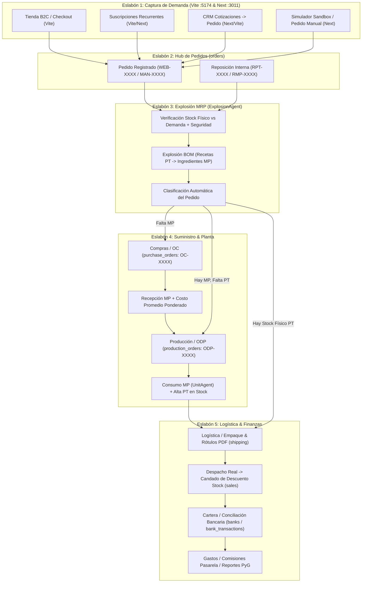
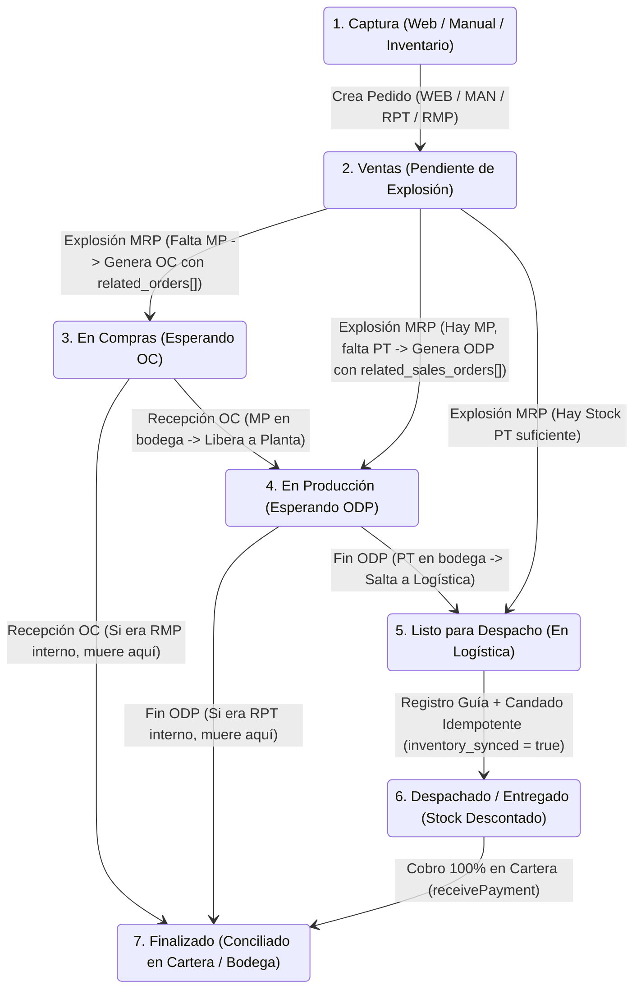
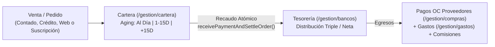
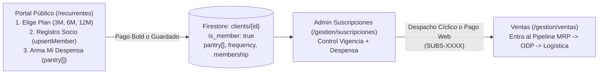

# 🛡️ Ecosistema Zeticas OS (`zeticas-next` Unificado: Storefront B2C/B2B + ERP Portal) — Contrato Canónico de Arquitectura (SPEC.md)

> **Estado del Contrato:** `v2.3 — CANONICAL PRODUCTION CERTIFIED (Resolución Integral de Deuda Técnica: Renumeración Canónica [DT-029]..[DT-033] + Higiene de Repositorio + Aislamiento de Backups + Telemetría de Orígenes de Tráfico)`  
> **Fecha de Emisión:** `2026-10-21` · **Última Enmienda:** `2026-10-30` (Auditoría Forense Tirano SDD: Resolución de colisiones numéricas [DT-026]..[DT-028] -> [DT-029]..[DT-031]; purga de carpeta residual src_SEGURIDAD_COPIA a _backups/ fuera del árbol de build y linters; verificación de compilador tsc EXIT 0 y static export EXIT 0; consolidación de historial git en zeticas-next)  
> **Gobernanza:** `arquitecto-sdd` · Silicon Valley Standard (Contract-First, Headless Core + Thin UI, Clean Boundary Harness)

---

## 0. Leyes Marciales de Arquitectura & Estrategia de Desarrollo

### 🔒 0.1 Núcleos Intocables (`READ-ONLY LOCK`)
Los siguientes motores deterministas y módulos certificados operan como **Núcleos Protegidos**. Queda estrictamente prohibido alterar sus firmas o algoritmos matemáticos sin una enmienda formal RFC en este `SPEC.md`:
1. **`UnitAgent` (`zeticas-next/src/lib/UnitAgent.ts`):** Guardián de conversión de unidades (`kg <-> gr`, `lb <-> gr`, `lt <-> ml`, `bulto <-> kg`, validación de `atado` con factor manual obligatorio).
2. **`InventoryAgent` (`zeticas-next/src/lib/agents/InventoryAgent.ts`):** Motor de costeo en cascada (`MP -> PT -> KIT`) y cálculo proyectado de reposición (`calculateReplenishment`).
3. **`ExplosionAgent` (`zeticas-next/src/lib/agents/ExplosionAgent.ts`):** Motor MRP/BOM de explosión consolidada de pedidos hacia Órdenes de Producción (`ODP`) y Órdenes de Compra (`OC`), respetando tamaños de lote (`batch_size`), stock físico, tránsito (`inPipe`) y stock de seguridad (`min_stock_level`).
4. **Storefront Público & Checkout B2C/Recurrentes (`zeticas-next/src/app/page.tsx`, `carrito/page.tsx`, `checkout/page.tsx`, `recurrentes/page.tsx`):** Flujo comercial activo en producción (`https://zeticas.com`).

### 🔌 0.2 Fuente Única de Verdad (`zeticas-next`) & Estrategia de "Cables Pelados"
A partir del **Cutover Productivo (`2026-10-25`)**, todo el ecosistema Zeticas (Storefront público + Portal Operativo ERP) reside y se despliega **EXCLUSIVAMENTE desde `zeticas-next` (`C:\Users\German Higuera\OneDrive\Documentos\Projects\zeticas-next`, Next.js 16 App Router + TypeScript, Puerto `3011`)** conectado a **Firebase Firestore (`delta-core-cloud-45ea0`)** bajo aislamiento Multi-Tenant (`tenants/{tenantId}/*`):
- **`zeticas-next` (`C:\Users\German Higuera\OneDrive\Documentos\Projects\zeticas-next`, Puerto `3011`):** **ÚNICA APLICACIÓN ACTIVA EN PRODUCCIÓN.** Sirve tanto el Storefront público (`https://zeticas.com` → target `hosting:zeticas`) como el Portal Operativo ERP (`https://zeticas-portal.web.app` → target `hosting:portal`) desde la exportación estática `out/` generada por `npm run build:static` / `npm run publish`.
- **`zeticas` (`C:\Users\German Higuera\OneDrive\Documentos\Projects\zeticas`, Vite Legacy):** **REPOSITORIO ARCHIVADO Y DESCOMISIONADO (`[LEGACY-VITE-LOCK-01]`).** Queda **TERMINANTEMENTE PROHIBIDO** editar código, compilar `vite build` (`dist/`) o desplegar desde la carpeta legacy `zeticas`.
- **Regla de Empalme:** Ninguna vista `.tsx` puede calcular costos de recetas, factores de conversión o explosiones de materiales por su cuenta; deben consumir exclusivamente las salidas tipadas de los Agentes Headless (`src/lib/agents/*`).

### 🚫 0.3 Prohibición de Reinventar & Ley de Iconografía
- **Iconografía Exclusiva:** Uso obligatorio de componentes vectoriales `lucide-react`. Prohibido introducir emojis unicode o librerías mezcladas en nuevos componentes UI.
- **Estandarización de Galerías:** Toda reforma de tablas operativas debe adoptar el estándar de contenedor `max-w-[1680px] mx-auto` y encabezado canónico único `.erp-sticky-dock` definido en `ZETICAs_DESIGN_SYSTEM.md`.

### 🧪 0.4 Aislamiento de Demos / Cuarentena (Sandbox Protection)
- El módulo **Simulador Web (`/gestion/simulador`)** y los clientes de prueba (`Test: Restaurante El Retiro`, etc.) solo pueden habilitarse cuando `canAccessSandbox === true` o bajo el tenant de pruebas (`delta`).
- Queda **bloqueada por contrato** cualquier escritura destructiva o de semillas de prueba sobre `tenantId === 'zeticas'` desde flujos de simulación (`isReadOnlyTenant` guard).

### 🛡️ 0.5 Ley Marcial de Despliegue & Candado Físico Anti-Regresión (`[LEGACY-VITE-LOCK-01]`)
Para impedir que una solicitud de `publish` o `deploy` ejecutada desde el workspace raíz (`zeticas`) vuelva a subir por accidente la versión antigua de Vite (`dist/` con el recuadro salmón antiguo):
1. **Todo comando de publicación o despliegue DEBE ejecutarse en `C:\Users\German Higuera\OneDrive\Documentos\Projects\zeticas-next`:**
   - Comando oficial: `npm run publish` (o `npm run build:static && npx firebase-tools deploy --only hosting:zeticas,hosting:portal`).
2. **Candado Físico en `zeticas/scripts/publish.mjs` y `zeticas/firebase.json`:**
   - `zeticas/scripts/publish.mjs` ha sido redirigido físicamente para ejecutar `zeticas-next/scripts/publish.mjs` y nunca `vite build`.
   - `zeticas/firebase.json` apunta `"public": "../zeticas-next/out"` (nunca `"dist"`), y la carpeta `zeticas/dist` ha sido eliminada.
3. **Política Anti-Caché de HTML (`Cache-Control: no-cache, no-store, must-revalidate`):**
   - `firebase.json` fuerza `no-cache, no-store, must-revalidate` sobre `/` y `**/*.@(html|json)` para que ni el navegador ni Cloudflare retengan HTML antiguo tras un despliegue, manteniendo `public, max-age=31536000, immutable` sobre `/_next/static/**`.

---

## 1. Misión del Sistema & Cadena Causal del Pipeline

### 1.1 Propósito Ejecutivo
Resolver de extremo a extremo la operación agroindustrial y comercial de **Zeticas SAS BIC** (y tenants B2B de **Delta CoreTech**): desde la captura de demanda multicanal (E-Commerce B2C, Suscripciones Recurrentes, CRM B2B y Venta Manual) hasta la explosión MRP de recetas (BOM), abastecimiento de materias primas (OC), control de piso de planta (ODP), despacho logístico con etiquetado PDF/código de barras y conciliación financiera en tiempo real (Cartera, Bancos y PyG).

### 1.2 Cadena Causal del Pipeline (Eslabones Dependientes)

### 1.3 Resolución Dinámica Multi-Tenant (`tenantId`)
Toda lectura y escritura en Firestore se resuelve mediante los helpers canónicos `tCol(collectionName)` y `tDoc(collectionName, docId)` que apuntan a:
$$\text{Ruta Canónica} = \texttt{tenants/\{tenantId\}/\{collectionName\}/\{docId\}}$$

| Tenant ID | Dominio / Hostname Producción | Puerto Local | Propósito Operativo |
| :--- | :--- | :--- | :--- |
| **`zeticas`** | `zeticas.com` / `zeticas-portal.web.app` | `:5174` / `:3011` (`?tenant=zeticas`) | Operación real en vivo de **Zeticas SAS BIC** |
| **`delta`** | `deltacoretech.com` | `:5174` / `:3011` (Default en `localhost`) | Entorno Demo B2B / Sandbox de pruebas **Delta CoreTech** |

---

## 2. Restricciones Técnicas & Modularidad (Headless Core + Thin UI)

### 2.1 Stack & Puertos Canónicos (`PROJECTS_PORTS_REGISTRY.md`)

| Parámetro | App Activa: `zeticas-next` (Storefront B2C/B2B + ERP Portal) | App Archivada: `zeticas` (Legacy Vite — `[LEGACY-VITE-LOCK-01]`) |
| :--- | :--- | :--- |
| **Directorio Raíz** | `C:\Users\German Higuera\OneDrive\Documentos\Projects\zeticas-next` | `C:\Users\German Higuera\OneDrive\Documentos\Projects\zeticas` |
| **Framework & Runtime** | Next.js 16.2.4 App Router + React 19.2 (TypeScript 5, Static Export `out/`) | React 19.2 + Vite 7.2 (**DESCOMISIONADO — PROHIBIDO COMPILAR O DESPLEGAR**) |
| **Puerto Local Sagrado** | **`3011`** (`next dev -p 3011 --webpack`) | `5174` (Inactivo / Histórico) |
| **Base de Datos** | Firebase Firestore (`delta-core-cloud-45ea0`, IndexedDB Persistent Cache) | N/A (Archivado) |
| **Target Firebase Hosting** | `hosting:zeticas` (`https://zeticas.com`), `hosting:portal` (`https://zeticas-portal.web.app`) y `hosting:deltacore` | **BLOQUEADO POR `zeticas/scripts/publish.mjs` (`EXIT 1`)** |

### 2.2 Auditoría de Modularidad & Monolitos Detectados (Regla `<= 600 líneas`)
El escaneo forense de `zeticas-next` registra los siguientes archivos que superan el límite de 600 líneas de `arquitecto-sdd` y quedan sujetos a desacoplamiento progresivo hacia `src/lib/` o subcomponentes:

| Repositorio | Archivo Monolito | Líneas | Diagnóstico Arquitectónico |
| :--- | :--- | :---: | :--- |
| **`zeticas-next`** | `src/app/recurrentes/page.tsx` | **2.025** | Portal público de Suscripciones ("Mi Despensa"), calculadora de planes, portal de socio y checkout Bold. |
| **`zeticas-next`** | `src/context/BusinessContext.tsx` | **1.923** | Orquestador central con listeners particionados *Lazy-Sticky* (`[PERF-FIRESTORE-01]`) y mutaciones transaccionales. |
| **`zeticas-next`** | `src/app/gestion/ventas/page.tsx` | **1.787** | Mezcla tabla de ventas, modal de explosión MRP, creación de órdenes y filtros. |
| **`zeticas-next`** | `src/app/checkout/page.tsx` | **1.609** | Checkout E-Commerce unificado (stepper de entrega, cálculo flete Interrapidísimo, Bold, liquidación bancaria triple y pantalla de éxito). |
| **`zeticas-next`** | `src/app/gestion/logistica/page.tsx` | **1.547** | Incrusta generador de etiquetas PDF (`jspdf`), control de cajas y despacho. |
| **`zeticas-next`** | `src/app/gestion/catalogo/page.tsx` | **1.484** | Maestro de SKUs (PT/MP/KIT), vinculación de proveedor principal (`[SUPP-01]`), código de barras (`next/dynamic`) y editor modal. |
| **`zeticas-next`** | `src/components/modals/NewOrderModal.tsx` | **927** | Modal de creación de pedidos con lógica de clientes y precios embebida. |
| **`zeticas-next`** | `src/app/gestion/simulador/page.tsx` | **920** | Simulador B2C + Suscripciones + Checkout en un solo componente. |
| **`zeticas-next`** | `src/app/carrito/page.tsx` | **907** | Canasta de compra con pedestales botánicos, barra de progreso de envío gratis y resumen editorial. |
| **`zeticas-next`** | `src/app/gestion/crm/page.tsx` | **906** | Embudo de leads, cotizador PDF y conversión a pedido en un solo archivo. |
| **`zeticas-next`** | `src/app/gestion/produccion/page.tsx` | **847** | Piso de planta ODP, control de mermas y cierre de lote. |

---

## 3. Modelo de Dominio, Diccionario de IDs Canónicos & Máquinas de Estado

### 3.1 Diccionario de Colecciones Firestore (`tenants/{tenantId}/*`) y Prefijos Canónicos

| Colección Firestore | Entidad de Dominio | Formato ID Canónico | Contador Atómico (`metadata/counters`) |
| :--- | :--- | :--- | :--- |
| **`products`** | Maestro Único de SKUs (`PT`, `MP`, `KIT`) | Firestore Auto-ID + campo `sku` (`PT-XXX`, `MP-XXX`, `KIT-XXX`) | N/A |
| **`recipes`** | Lista de Materiales / BOM por `finished_good_id` | Firestore Auto-ID | N/A |
| **`orders`** | Pedidos Comerciales e Internos | `WEB-0001`, `MAN-0001`, `RPT-0001`, `RMP-0001`, `INT-PT-0001` | `last_order_number`, `last_rpt_number`, `last_rmp_number`, `last_internal_number` |
| **`purchase_orders`** | Órdenes de Compra a Proveedores (OC) | `OC-0001` (Baseline `>= 350`) | `last_oc_number` |
| **`production_orders`** | Órdenes de Producción en Planta (ODP) | `ODP-0001` (Baseline `>= 350`) | `last_odp_number` |
| **`clients`** | Maestro de Clientes B2C/B2B & Membresías | `CLI-0001` o Auto-ID | `last_client_number` |
| **`suppliers`** | Directorio de Proveedores y `supplied_items[]` | Firestore Auto-ID | N/A |
| **`banks`** | Cuentas Bancarias / Tesorería | Firestore Auto-ID | N/A |
| **`bank_transactions`** | Libro Mayor de Movimientos (`income` / `expense`) | Firestore Auto-ID | N/A |
| **`expenses`** | Gastos Operativos y Comisiones Bancarias | Firestore Auto-ID | N/A |
| **`leads`** | Prospectos Comerciales CRM | Firestore Auto-ID | N/A |
| **`quotations`** | Cotizaciones Comerciales B2B | Firestore Auto-ID | N/A |
| **`rejected_products`** | Registro de Mermas / Rechazos de Calidad | Firestore Auto-ID | N/A |
| **`site_content`** | CMS Web (`public_site`, `web_shipping`, `recurring`, `tax_settings`) | Firestore Auto-ID (`section` + `key`) | N/A |
| **`users`** | Usuarios Administrativos y Roles (`super_admin`, `admin`, `operador`) | Firestore Auto-ID / UID | N/A |
| **`audit` / `admin_logs`** | Bitácora Forense de Acciones Críticas | Firestore Auto-ID | N/A |

### 3.2 Contrato de Datos del Maestro `products` (Invariante de Stock y Costo)
- **Fórmula Canónica de Stock Físico Actual:**
  $$\text{stock\_actual} = \text{Number}(\texttt{initial} \parallel 0) + \text{Number}(\texttt{purchases} \parallel 0) - \text{Number}(\texttt{sales} \parallel 0)$$
- **Invariante de Costo en `MP` (Materia Prima):**
  - `purchase_unit`: Unidad de compra al proveedor (`kg`, `lt`, `bulto`, `atado`, `und`).
  - `unit_measure`: Unidad base de uso en receta (`gr`, `ml`, `und`).
  - `conversion_factor`: Factor obligatorio ($> 0$). Para `atado`, debe ser manual ($\neq 1$).
  - `purchase_cost`: Precio por empaque de compra.
  - `cost` / `avgCost`: Costo por unidad base de uso ($\texttt{purchase\_cost} / \texttt{conversion\_factor}$), recalculado por **Costo Promedio Ponderado** en cada recepción de compra (`receivePurchase`).

### 3.3 Máquinas de Estado Finitas (FSM) & Las 5 Leyes de Flujo del Pipeline

#### A. FSM Unificada del Pipeline Operativo (`orders` + `OC` + `ODP`)

#### B. Las 6 Leyes Innegociables de Transición entre Eslabones (`[PIPE-00]` a `[PIPE-05]`)

0. **`[PIPE-00]` Ley de Asignación FIFO de Stock Comprometido y Ecuación Neta con `inProgress` (`ExplosionAgent`):**
   - **Prohibición de Sobre-Asignación (Stock Comprometido):** Al clasificar múltiples pedidos hacia `'Listo para Despacho'`, `ExplosionAgent` debe mantener una bolsa dinámica decreciente en memoria (`runningAvailableStock = physicalStock - committedInLogistics`), restando las unidades asignadas a cada pedido en orden FIFO. Queda prohibido comparar cada pedido de forma aislada contra `physicalStock`.
   - **Respeto Estricto de `inProgress` (Cero Bola de Nieve):** La ecuación de déficit neto de Producto Terminado (PT) debe descontar las órdenes de producción activas (`inProgress`):
     $$\text{Faltante Neto PT} = \max\Big(0,\; (\text{Demanda Viva Total} + \text{Stock Seguridad}) - (\text{Stock Físico} + \text{ODPs en Curso})\Big)$$
   - Si una `ODP` en curso ya cubre el lote requerido, los nuevos pedidos se vinculan a `related_sales_orders` sin duplicar cantidades a producir ni duplicar compras de materia prima (`OC`).

1. **`[PIPE-01]` Visibilidad Controlada de Reposiciones (`RPT` / `RMP`) de Inventario a Ventas:**
   - Los pedidos internos generados por `generateReplenishment` (`source: 'RPT' | 'RMP'`) en estado `Pendiente` **deben ser visibles y seleccionables en la pestaña "Pendientes" de Ventas (`/gestion/ventas`)** con etiqueta `REPOSICIÓN INTERNA` para ser incluidos en la Explosión Consolidada.
   - Quedan **excluidos por contrato** de los KPIs financieros (`$` de Ventas/Reportes), del módulo de **Cartera** y de la bandeja de **Logística/Despachos**.

2. **`[PIPE-02]` Desglose Recursivo de `KITs` en Explosión MRP y Compuerta Estricta de Logística:**
   - **Descomposición BOM de `KIT`:** Antes de calcular necesidades de PT y MP, `ExplosionAgent.calculateGlobalExplosion()` debe desglosar todo ítem con `type === 'KIT'` en sus `components[]` constituyentes (multiplicando `component.qty * orderItem.quantity`).
   - **Compuerta de Entrada a Logística:** Un pedido comercial **solo puede ingresar a la bandeja activa de Logística (`/gestion/logistica`)** cuando su `logistics_status === 'Listo para Despacho'` (o `status` sea `'Listo para Despacho' | 'Empacado'`). Mientras `logistics_status` sea `'En Compras'` o `'En Producción'`, permanece bloqueado fuera de Logística.

3. **`[PIPE-03]` Independencia de Ejes en Compras (`OC`: Recepción Física vs. Pago Tesorería) y Liberación Automática:**
   - Cada Orden de Compra (`purchase_orders`) gobierna **dos máquinas de estado ortogonales (independientes)**:
     - **Eje Físico (Almacén):** `status`: `Pendiente` $\xrightarrow{\text{receivePurchase()}}$ `Recibida` (incrementa `products.purchases`, recalcula `avgCost` por Costo Promedio Ponderado y dispara `recalculateAllCosts()`). **No requiere pago previo en Tesorería** (soporta compras a crédito o contraentrega).
     - **Eje Financiero (Tesorería):** `payment_status`: `Pendiente` $\xrightarrow{\text{payPurchase()}}$ `Pagado` (descuenta `banks.balance` y registra asiento en `bank_transactions`).
   - **Propagación de Recepción (`related_orders[]`):** Toda `OC` creada por explosión debe persistir `related_orders: string[]`. Al ejecutarse `receivePurchase()`:
     - Si el pedido vinculado es `RMP-XXXX`, transiciona automáticamente a `status: 'Finalizado'`.
     - Si el pedido vinculado es comercial y estaba en `logistics_status: 'En Compras'`, transiciona automáticamente a `logistics_status: 'En Producción'`.

4. **`[PIPE-04]` Liberación Automática de Planta (`ODP`) hacia Logística y Registro de Mermas:**
   - **FSM de `production_orders` (ODP):** `PROGRAMADA` (`TO_DO` / `SCHEDULED`) $\xrightarrow{\text{Inicio + consumeMaterials()}}$ `EN_PLANTA` (`IN_PROGRESS`) $\xrightarrow{\text{confirmFinishOdp()}}$ `DONE`.
   - Al cerrar una ODP (`confirmFinishOdp()`):
     1. Incrementa el stock de PT en `netQty = Math.max(0, qty - waste)` vía `loadFinishedGoods()`.
     2. Si `waste > 0`, crea automáticamente el registro de auditoría en `rejected_products`.
     3. Recorre `odp.related_sales_orders`:
        - Si el pedido vinculado es `RPT-XXXX`, lo cierra automáticamente en `status: 'Finalizado'` (muerte de flujo en bodega).
        - Si el pedido vinculado es comercial (y no tiene otras ODPs abiertas pendientes), actualiza automáticamente su `logistics_status` a **`'Listo para Despacho'`**, habilitándolo de inmediato en Logística.

5. **`[PIPE-05]` Candado Idempotente de Descuento de Stock en Despacho (`inventory_synced`):**
   - El descuento físico de inventario comercial (`products.sales += qty`) ocurre **única y exclusivamente** cuando el pedido transiciona a `'Despachado'` o `'Entregado'` en Logística.
   - Si el pedido contiene un `KIT`, el descuento se propaga a sus componentes o al SKU según configuración de empaque.
   - La transacción de Firestore **debe persistir `inventory_synced: true` y `inventory_synced_at: ISOString`** en el documento del pedido, abortando cualquier nuevo descuento si `orderData.inventory_synced === true` o si el estado previo ya pertenecía a `['Despachado', 'Entregado', 'Finalizado']`.

#### C. Las 4 Leyes de Exactitud Matemática de Inventarios (`[INV-01]` a `[INV-04]`)

1. **`[INV-01]` Normalización de Unidades de Tránsito en Materia Prima (`en_transito` / `inPipeBase`):**
   - Toda Materia Prima (`type === 'MP'`) almacena su stock físico (`initial`, `purchases`, `sales`) en **Unidad Base de Uso** (`unit_measure`: `gr`, `ml`, `und`), mientras que las Órdenes de Compra (`purchase_orders.items[].quantity`) se expresan en **Unidad de Compra/Empaque** (`purchase_unit`: `kg`, `bulto`, `cja`, `atado`).
   - Queda **terminantemente prohibido** sumar `ocItem.quantity` directamente al tránsito base sin multiplicar por su factor de conversión (`factor = ocItem.factor || item.conversion_factor || 1`).
   - Ecuación obligatoria en `BusinessContext.tsx`, `InventoryAgent.ts` y `ExplosionAgent.ts`:
     $$\text{Tránsito Base MP} = \sum \big(\text{ocItem.quantity} \times \text{conversion\_factor}\big)$$

2. **`[INV-02]` Descuento Atómico de Componentes al Despachar un `KIT` (`updateOrder`):**
   - Un `KIT` (ancheta/caja regalo) es un ensamble comercial virtual compuesto por `product.components[]` (frascos de PT + empaques de MP).
   - Cuando un pedido pasa a `'Despachado'` o `'Entregado'`, la transacción de inventario en `BusinessContext.tsx` debe:
     1. Incrementar `sales` en cada uno de los `components[]` reales del `KIT` ($\text{component.qty} \times \text{orderItem.quantity}$), descontando los frascos y cajas físicos que salieron de la bodega.
     2. Registrar la salida comercial del `KIT` para trazabilidad de ventas sin generar stock negativo fantasma en PT.

3. **`[INV-03]` Auditoría de Inventario Físico con Kardex Inmutable (`auditStockAdjustment`):**
   - Queda prohibido que un ajuste de inventario físico (`auditStockAdjustment`) borre silenciosamente la historia sin dejar rastro.
   - Todo ajuste físico debe ejecutarse en una transacción que:
     1. Calcule `previous_stock = initial + purchases - sales` y `delta = newVal - previous_stock`.
     2. Ajuste `initial` (o consolide el corte) preservando o registrando el corte en `audit_logs` (`action: 'STOCK_ADJUSTMENT'`) con `{ product_id, sku, name, previous_stock, new_stock: newVal, delta, reason, user_email, timestamp }`.

4. **`[INV-04]` Fórmula Única de Stock Físico en Toda la Aplicación (`Single Source of Truth`):**
   - Dado que `receivePurchase()` ya multiplica los paquetes recibidos por `conversion_factor` antes de guardar en `products.purchases`, el stock físico en unidad base es **siempre**:
     $$\text{stock\_actual} = \text{initial} + \text{purchases} - \text{sales}$$
   - Queda **prohibido** volver a multiplicar `purchases * conversion_factor` en vistas secundarias (como ocurría en `produccion/page.tsx` línea 640, lo cual inflaba artificialmente la disponibilidad de MP en el semáforo de cocina).

#### D. Las 8 Leyes del "Reloj Suizo" en Cocina / Producción (`[KITCHEN-01]` a `[KITCHEN-08]`)

1. **`[KITCHEN-01]` Olla Sellada en Marcha (`IN_PROGRESS` Lock):**
   - Mientras una ODP está en estado `'PROGRAMADA'` o `'TO_DO'` (en cola, antes de encender fogón), `runConsolidatedExplosion` puede consolidarle nuevos batches del mismo SKU.
   - Una vez que el operario inicia la ODP (`status === 'IN_PROGRESS'`, materia prima ya pesada y descontada con `mp_synced: true`, y cronómetro corriendo), **la ODP queda SELLADA (`LOCKED`)**. Si entra nueva demanda para ese mismo SKU, `runConsolidatedExplosion` **debe crear una nueva ODP separada** en estado `'PROGRAMADA'` para no alterar una cocción en curso ni omitir el descuento de MP del nuevo lote.

2. **`[KITCHEN-02]` Unidad Canónica de Batch y Conversión Exacta de Receta (`BOM Scaling`):**
   - El rendimiento por batch (`unitsPerBatch`) y el número de batches (`numBatches`) deben calcularse con una única función compartida entre el Semáforo de Insumos (`ODPCardActionable`), el Modal de Consumo (`handleStartOdp`) y el `ExplosionAgent`:
     $$\text{unitsPerBatch} = \text{Number}(\text{product.batch\_size}) || \text{Number}(\text{recipe}[0].\text{yield\_quantity}) || 1$$
     $$\text{numBatches} = \frac{\text{odp.quantity}}{\text{unitsPerBatch}}$$
   - Toda cantidad de ingrediente requerida (`ingQty * numBatches` en `ing.unit`) debe convertirse a la unidad base del inventario (`mpItem.unit_measure`) usando `UnitAgent.convert()` (con soporte para `conversion_factor` personalizado cuando `purchase_unit` es `atado`, `bulto`, `cja` o `paq`).

3. **`[KITCHEN-03]` Cierre Atómico de Lote (`confirmFinishOdp` Transaccional y Preservación de `sku`):**
   - Al finalizar una ODP (`confirmFinishOdp`), queda prohibido pasar `odp.id` en el parámetro `sku` de `saveOdp(sku, payload)` (lo cual sobreescribía el nombre del producto con `"ODP-XXXX"`).
   - El cierre de la ODP debe ejecutarse de forma atómica realizando los **5 pasos del reloj suizo**:
     1. Incrementar `products.purchases` del PT en `netQty = Math.max(0, qty - waste)` usando `increment(netQty)` en Firestore (sin depender de cachés locales).
     2. Actualizar la ODP a `status: 'DONE'`, preservando `sku: odp.sku`, guardando `quantity: qty`, `waste_qty: waste`, `net_quantity: netQty`, `elapsed_time: finishModal.elapsed` y `completed_at: ISOString`.
     3. Si `waste > 0`, insertar registro en `rejected_products` con lote, SKU, cantidad rechazada y responsable.
     4. Si a causa de la merma (`waste > 0`) el stock físico resultante no alcanza a cubrir la demanda de los pedidos vinculados (`netYield + stockPrevio < demandaVinculada`), disparar automáticamente la orden `RPT-XXXX` de reposición por defecto de calidad por las unidades faltantes.
     5. Transicionar los pedidos vinculados en `odp.related_sales_orders`: cerrar los `RPT-XXXX` a `'Finalizado'`, y pasar los pedidos comerciales cubiertos a `logistics_status: 'Listo para Despacho'`.

4. **`[KITCHEN-04]` Bloqueo de Doble Descuento de Materia Prima (`mp_synced` Guard):**
   - Si una ODP ya tiene `mp_synced === true`, `confirmStartWithMp` no puede volver a descontar la misma materia prima aunque la orden se reinicie o se reabra, garantizando simetría 1:1 entre ollas cocinadas y gramos descontados de bodega.

5. **`[KITCHEN-05]` Exclusión de ODPs con `mp_synced === true` en Explosión de Materia Prima (`ExplosionAgent`):**
   - Al proyectar la demanda de Materia Prima de ODPs activas (`ExplosionAgent.ts` bloque `3.1`), **quedan excluidas todas las ODPs que ya tengan `mp_synced === true` (o `status === 'IN_PROGRESS'`)**, dado que sus ingredientes ya fueron descontados físicamente de `stockBase` al iniciar la cocción. Solo las ODPs en estado `'PROGRAMADA' | 'TO_DO'` con `mp_synced !== true` reservan MP pendiente por consumir.

6. **`[KITCHEN-06]` Conciliación de Rendimiento Real (`actual_qty`) y Ajuste Diferencial de Envases/Tapas al Cierre:**
   - En el cierre de lote (`confirmFinishOdp`), el jefe de cocina puede reportar tanto la **Cantidad Real Obtenida (`actual_qty`, permitiendo sobre-rendimiento o sub-rendimiento de marmita)** como las **Unidades Rechazadas por Calidad (`waste_qty`)**.
   - Si `actual_qty !== odp.quantity` (la marmita rindió más o menos frascos de los teóricos), el cierre ajusta automáticamente en inventario la diferencia de insumos unitarios de envase (`unit_measure === 'und'`: frascos, tapas, etiquetas) para que el stock de envases coincida al 100% con los frascos físicamente llenados.

7. **`[KITCHEN-07]` Semáforo de Insumos con Reserva en Cascada FIFO en Cola de Planta:**
   - La vista `/gestion/produccion` debe calcular una bolsa decreciente de stock de MP (`runningMpStock`) ordenada por prioridad (`is_priority` descendente y `created_at` ascendente). Cada tarjeta `ODPCardActionable` en espera consume virtualmente de `runningMpStock`, impidiendo que múltiples ODPs en cola marquen `100% LISTO PARA PRODUCIR` con los mismos gramos de materia prima.

8. **`[KITCHEN-08]` Atomicidad `writeBatch` y Unificación de Costos en Ingeniería de Recetas (`recetas/page.tsx`):**
   - La actualización de una receta debe ejecutarse en un único `writeBatch(db)` atómico (borrado de líneas previas + inserción de líneas nuevas + actualización de `products.cost` y `products.batch_size`), persistiendo simultáneamente `batch_size` y `yield_quantity` y calculando el costo exclusivamente mediante `InventoryAgent.calculatePTCost()`.

#### E. Pipeline Financiero: Cartera, Pasarelas (Bold/Wompi) y Tesorería/Bancos (`[FIN-01]` a `[FIN-05]`)

1. **`[FIN-01]` Transacción Atómica Única en Recaudo de Cartera (`receivePayment` + `updateOrder`):**
   - Queda prohibido ejecutar `receivePayment()` y `updateOrder()` como dos llamadas separadas en `cartera/page.tsx` (`L221-236`), ya que un fallo intermedio suma el dinero al banco pero deja la factura abierta por cobrar.
   - El cobro de una factura en Cartera debe ejecutarse dentro de **una sola transacción de Firestore** que simultáneamente:
     1. Incremente el saldo neto del banco (`balance` y `real_time` en `banks/{bankId}`).
     2. Inserte el asiento de ingreso en `bank_transactions` (`category: 'Cobro de Venta'`, `related_id: orderId`).
     3. Si `commission > 0`, inserte el gasto automático en `expenses` y su asiento en `bank_transactions` (`category: 'Comisiones Bancarias'`).
     4. Actualice `orders/{orderId}` con `paid_amount: previousPaid + paymentAmount` y `payment_status: isFullyPaid ? 'Pagado' : 'Abono Parcial'`.

2. **`[FIN-02]` Unificación de Fórmula de Comisión de Pasarela (`Bold` / `Wompi`) y Recálculo Reactivo:**
   - La comisión de pasarela en `cartera/page.tsx` debe recalcularse automáticamente tanto al cambiar el método de pago como al editar el input `paymentAmount`.
   - Para pagos vía **Bold** (tanto en Checkout Web, Suscripciones como en Cartera), la fórmula canónica colombiana es:
     $$\text{Comisión Bold} = \text{round}\Big(\big(\text{Monto} \times 0.0299 + 900\big) \times 1.19\Big)$$
   - En pagos de Checkout Web y Suscripciones con envío (`shippingPaid > 0`), se mantiene la **Distribución Bancaria Triple**:
     - **Cuenta Principal (BBVA):** $\text{Total Pagado} - \text{Envío} - \text{Comisión Bold}$.
     - **Cuenta Comisiones (Bold):** $\text{Comisión Bold}$ (y contrapartida en `expenses`).
     - **Cuenta Logística (Interrapidísimo Costo de Envío):** $\text{Envío Pagado}$.

3. **`[FIN-03]` Filtro Estricto de Fecha en KPI "Recaudo del Día" (`cartera/page.tsx`):**
   - El KPI `Recaudo del Día` en `/gestion/cartera` (`L156-160`) **debe filtrar estrictamente las transacciones cuya fecha (`created_at`) corresponda al día calendario actual (`es-CO`)**, prohibiendo sumar todo el historial de los últimos 100 cobros.

4. **`[FIN-04]` Exclusión de Órdenes Internas (`RPT` / `RMP`) de Cartera:**
   - Ninguna orden con `source === 'RPT' | 'RMP'` o `payment_status === 'Interno'` puede aparecer en `invoicesList` de `/gestion/cartera`.

5. **`[FIN-05]` Pasivo de Proveedores (Cuentas por Pagar) Visible en Tesorería (`/gestion/bancos`):**
   - Las Órdenes de Compra (`purchase_orders`) que ya fueron recibidas o comprometidas pero tienen `payment_status === 'Pendiente'` deben totalizarse como **Pasivo exigible de corto plazo (Cuentas por Pagar a Proveedores)** en el monitor de liquidez de `/gestion/bancos`, mostrando la **Liquidez Disponible Real = Liquidez en Bancos - Cuentas por Pagar Pendientes**.

#### F. Pipeline de Clientes, Clientes Recurrentes ("Mi Despensa") y Suscripciones (`[SUBS-01]` a `[SUBS-07]`)

1. **`[SUBS-01]` Migración Integral del Motor de Socios a `zeticas-next/src/context/BusinessContext.tsx`:**
   - Para soportar `/recurrentes` y `/checkout` dentro de `zeticas-next`, `BusinessContext.tsx` debe incorporar los métodos canónicos que hoy solo existen en Vite:
     - `upsertMember(memberData)`: Crea o actualiza el documento en `clients` buscando por `nit` o `email` normalizado (evitando clientes duplicados), haciendo **merge profundo de `existingData.membership` y `data.membership`** para preservar siempre `membership.created_at`, recalculando `membership_expiry` en cada cambio de plan o despensa, y sincronizando `is_member: true`, `role: 'member'`, `plan`, `pantry[]`, `frequency` (`'Semanal' | 'Quincenal' | 'Mensual'`) y `membership: { plan, status, created_at, updated_at, expiry_date }`.
     - `saveWebCheckout(draftData)`, `getWebCheckout(chkID)` y `updateWebCheckoutStatus(chkID, status)` sobre la colección `tenants/{tenantId}/web_checkouts`.
     - `sendWelcomeEmail(memberData, plan, summaryData)` encolando en la colección `mail`.

2. **`[SUBS-02]` Regla de Oro de Liquidación de "Mi Despensa" y Persistencia de Descuento (`Recurring Pricing Engine`):**
   - Los parámetros de los planes (`3 Meses`, `6 Meses`, `12 Meses`) se leen en vivo de `siteContent.recurring` (`plan_{M}_discount`, `plan_{M}_threshold`, `plan_{M}_price`, `plan_{M}_shipping`):
     - Precio unitario con descuento redondeado a múltiplo de `$50 COP` (aplicado idénticamente en tarjetas, resumen lateral, borrador Bold, pedido `SUBS-XXXX` y Admin `/gestion/suscripciones`):
       $$\text{unit\_price\_discounted} = \lceil \frac{\text{list\_price} \times (1 - \text{plan\_discount}/100)}{50} \rceil \times 50$$
     - Envío gratis si `freeShipping === true` en el plan o si $\sum \text{discountedProducts} \ge \text{threshold}$.
     - Total a cobrar: $\max(\text{monthlyPrice}, \sum \text{discountedProducts}) + \text{shippingCost}$.
   - **Prohibición de Pérdida de Descuento en `draft.pantry` y `orders.items[]`:** Tanto al guardar `pantry` en el cliente (`upsertMember`) como al guardar el borrador de pago (`saveWebCheckout`) y al crear el pedido oficial `SUBS-XXXX` (`addOrder`), cada ítem debe persistir obligatoriamente `{ id, sku, name, quantity, list_price, discount_pct, price: unit_price_discounted }`. Queda prohibido guardar solo `{ id, quantity }` en el borrador de Bold o pasar el precio de lista sin descuento al pedido de Ventas.

3. **`[SUBS-03]` Disparo de Pedido de Suscripción y Visibilidad de Descuento en `/gestion/suscripciones` (`MemberDrawer` $\rightarrow$ `Ventas`):**
   - En `/gestion/suscripciones` (`suscripciones/page.tsx`), tanto el KPI `Revenue Est.` como el `MemberDrawer` deben liquidar la despensa de cada socio aplicando el `% de descuento` de su plan activo (`3 Meses`, `6 Meses` o `12 Meses`), mostrando el precio de lista tachado, el porcentaje de beneficio y el neto real.
   - El panel lateral `MemberDrawer` debe incluir la acción **`"Generar Pedido del Ciclo (SUBS-XXXX)"`**, la cual toma la despensa activa del socio (`member.pantry`), aplica `unit_price_discounted` según su plan vigente y crea el pedido oficial en `orders` (`source: 'Suscripción Web'`, `status: 'Pendiente'`) para que entre de inmediato al pipeline de Explosión MRP, Cocina y Logística.

4. **`[SUBS-04]` Unificación del Estado de Archivado entre `/gestion/clientes` y `/gestion/suscripciones`:**
   - Queda prohibido que `clientes/page.tsx` filtre por `client.archived === true` mientras `suscripciones/page.tsx` filtra por `client.status === 'Archived'`.
   - Al archivar o restaurar un cliente/socio desde cualquiera de los dos módulos, `BusinessContext` debe sincronizar **ambos campos simultáneamente**: `{ status: 'Archived', archived: true, archived_at: ISOString }` (y al restaurar: `{ status: 'Active', archived: false, archived_at: null }`).

5. **`[SUBS-05]` Plazo de Pago Maestro en Clientes (`payment_terms`) Heredado a Ventas y Cartera:**
   - El Maestro de Clientes (`/gestion/clientes`) debe permitir configurar el **Plazo de Pago por defecto (`payment_terms`: `0` Contado, `15`, `30`, `45` o `60` días)** y deduplicar por `nit`/`email`. Cuando se crea un pedido manual o B2B en `/gestion/ventas` para ese cliente, el pedido hereda automáticamente su `payment_terms`, alimentando sin fricción el cálculo de vencimiento y mora en `/gestion/cartera`.

6. **`[SUBS-06]` Matriz Completa de Planes de Suscripción en `/gestion/web-cms` (`web-cms/page.tsx`):**
   - La pestaña `"Clientes Recurrentes"` en `/gestion/web-cms` de Next.js debe incluir la matriz editable completa para los 3 planes (`3 Meses`, `6 Meses`, `12 Meses`): `% Descuento` (`plan_{M}_discount`), `Tope Envío Gratis ($)` (`plan_{M}_threshold`), `Mínimo Mensual ($)` (`plan_{M}_price`) y `Envío Gratis Siempre (Switch)` (`plan_{M}_shipping`).

7. **`[SUBS-07]` Flujo E2E de Autogestión del Socio en `/recurrentes` (Paso 1 a Paso 5, Persistencia Real de Configuración y Continuidad de Sesión):**
   - **Paso 1 (Landing Círculo) $\leftrightarrow$ Paso 2 (Escoge tu Plan):** El botón `VOLVER AL INICIO` en el Paso 2 regresa al Paso 1 (`setStep(1)` sin abandonar `/recurrentes`). Las 3 tarjetas de plan (`3 Meses`, `6 Meses`, `12 Meses`) presentan insignias editoriales (`IDEAL PARA EMPEZAR`, `MÁS ELEGIDO`, `MÁXIMO BENEFICIO`) y botones de alto contraste en `#025357`.
   - **Paso 3 (Autenticación Contextual):** La tarjeta resumen `Tu Selección` (`plan` + `frequency`) se renderiza **exclusivamente** cuando `authMode === 'register'`. Las vistas `Bienvenido` (`authMode === 'login'`) y `Recuperar Contraseña` (`authMode === 'forgot'`) muestran tarjetas limpias centradas en el acceso o restablecimiento OTP.
   - **Paso 4 (Arma tu Despensa y Modal *Personaliza tu Membresía*):**
     - Las miniaturas de producto se renderizan con `objectFit: 'contain'` sobre pedestal `#FDF8F6` (prohibido recortar frascos con `objectFit: 'cover'`).
     - **Prohibición de Falso Positivo en Modal (`handleSaveModalConfig`):** Al pulsar `GUARDAR NUEVA CONFIGURACIÓN` en el modal `isChangingPlan`, el sistema debe persistir inmediatamente en Firestore (`upsertMember`) el nuevo `plan`, `frequency`, `membership_expiry` y la `pantry` recalculada con el nuevo `% de descuento` y redondeo a `$50 COP`, sincronizando `AuthContext` (`directLogin`) y mostrando un banner de confirmación (`role="status"`).
   - **Paso 4 $\rightarrow$ Paso 5 (`finalizeMembership` y Continuidad de Sesión):**
     - Queda prohibido cerrar la sesión (`logout()`) cuando un miembro activo actualiza su despensa en el Paso 4; el sistema debe sincronizar `directLogin(res.data)` y confirmar en pantalla.
     - En el primer registro (`isFirstTimeOnboarding`), tras guardar la despensa y enviar el correo de bienvenida (`welcome_email_sent: true`), el Paso 5 (*¡Despensa Guardada con Éxito!*) permite regresar directamente al portal autenticado (Paso 4) al pulsar `INGRESAR A MI PORTAL`.

8. **`[SUBS-08]` Automatización y Sistematización del Ciclo de Cobro & Correo de Bienvenida de Alta Gama (Opción A):**
   - **Plantilla HTML Institucional de Bienvenida (`sendWelcomeEmail`):**
     - Sustituye el texto plano por un correo estructurado con el diseño botánico oficial de Zeticas (`#025357`, `#D6BD98`, `#AFBF71`, tipografía y tabla limpia), detallando:
       1. Nombre del suscriptor y bienvenida personalizada al Club Mi Despensa.
       2. Plan elegido (`3 Meses`, `6 Meses`, `12 Meses`) y frecuencia pactada (`Quincenal` / `Mensual`).
       3. Detalle completo de los frascos seleccionados en la despensa con cantidades y precios con descuento de socio.
       4. Subtotal, flete (o etiqueta *Envío Gratis*) y total liquidado.
       5. Mensaje explicativo sobre la dinámica del club: los pedidos se despachan en cada ciclo y el socio puede modificar sus sabores en cualquier momento desde `https://zeticas.com/recurrentes`.
   - **Notificación y Cobro en Despacho Cíclico (`/gestion/suscripciones`):**
     - Al presionar *"Generar Pedido del Ciclo (SUBS-XXXX)"* en `MemberDrawer`:
       1. Se genera la orden en `orders` con su `order_number: SUBS-XXXXXX` y los precios descontados según el plan.
       2. Si la orden no es prepagada (`cyclePaymentMode !== 'Prepagado'`), se encola automáticamente en `mail` una **Notificación de Entrega y Cobro Cíclico** dirigida al socio con el desglose de su pedido y enlace directo para pagar en línea o confirmar su despacho.
       3. Se incluye copia oculta a `zeticas@gmail.com` para que el equipo operativo tenga trazabilidad en tiempo real.
   - **Claridad de Negocio para el Cliente:**
     - En Colombia, las pasarelas estándar (Bold) requieren confirmación del usuario para pagos recurrentes; el sistema automatiza la generación de la orden con descuento, el aviso por correo al cliente y el registro contable en Cartera, eliminando cálculos manuales y llamadas operativas.

#### G. Pipeline del Maestro de Proveedores y Matriz de Abastecimiento (`[SUPP-01]` a `[SUPP-03]`)

1. **`[SUPP-01]` Sincronización Bidireccional `Proveedor <-> Materia Prima` (`supplied_items[]` $\leftrightarrow$ `product.provider_id`):**
   - Cuando en `/gestion/proveedores` (`proveedores/page.tsx`) se asignan o desasignan insumos en el portafolio de un proveedor (`supplied_items: string[]`), `updateSupplier`/`addSupplier` debe sincronizar en un `writeBatch` el campo `provider_id` (y `main_provider`) en los documentos correspondientes de `products/{itemId}`.
   - De igual forma, si en `/gestion/catalogo` se asigna un proveedor a una Materia Prima, ese `itemId` debe quedar incluido en `supplier.supplied_items[]`, garantizando que `ExplosionAgent.ts` (`L247-262`) nunca deje una Orden de Compra bajo `'SIN_PROVEEDOR'` si el vínculo fue creado en cualquiera de las dos pantallas.

2. **`[SUPP-02]` Unificación del Filtro de Ítems Abastecibles en KPI de Cobertura (`proveedores/page.tsx`):**
   - Tanto el KPI `Cobertura de Suministros` (`supplyStats` en `L63`) como el selector del modal (`supplyItems` en `L84`) deben usar exactamente el mismo predicado canónico de Materia Prima/Insumos (`['MP', 'INSUMO', 'EMPAQUE', 'MATERIAL']`), eliminando desfases entre el porcentaje de cobertura y la lista de selección.

3. **`[SUPP-03]` Unificación del Estado de Archivado de Proveedores:**
   - `archiveSupplier` y `updateSupplier` deben mantener sincronizados `{ status: 'archived', archived: true }` al archivar y `{ status: 'active', archived: false }` al restaurar.

#### H. Pipeline de Pasarela de Pagos (`Bold.co`): Firma Server-Side, Idempotencia y Conciliación (`[PAY-01]` a `[PAY-05]`)

1. **`[PAY-01]` Firma de Integridad SHA-256 Híbrida (`/api/payments/bold-signature` + Fallback `[DEPLOY-CUTOVER-01]`):**
   - En `zeticas-next`, el frontend solicita la firma a través de `resolveBoldSignature()` (`src/lib/boldGateway.ts`), que invoca en primer lugar el Route Handler privado (`POST /api/payments/bold-signature` operando sobre Firestore REST v1 sin gRPC) y aplica fallback con Web Crypto (`window.crypto.subtle.digest('SHA-256')`) únicamente en entornos de exportación estática pura (`out/`) según `[DEPLOY-CUTOVER-01]`.

2. **`[PAY-02]` Prohibición Absoluta de Aprobación sin Estado Explícito (`!boldStatus` Bypass Fix):**
   - Queda **terminantemente prohibido** aprobar un pago cuando el parámetro de estado de Bold viene vacío (`!boldStatus` en `Checkout.jsx:416` y `RecurringCustomers.jsx:337`), ya que cuando un comprador cierra o cancela la pasarela y regresa a `?chkID=xxx`, el sistema registraba el pedido como `'Pagado'` e inyectaba dinero inexistente en BBVA.
   - El retorno de Bold debe leer los parámetros oficiales (`bold-tx-status` / `bold-status` / `status`) y **solo** ejecutar el flujo de éxito (`handleSuccess` / `handleBoldSuccess`) cuando el estado sea explícitamente `'approved' | 'successful' | 'success'`. Si es `'rejected' | 'failed' | 'cancelled'` o ausente, debe mantener el borrador en `'pending' | 'rejected'` y mostrar alerta de reintento sin tocar Ventas ni Bancos.

3. **`[PAY-03]` Idempotencia Transaccional de `web_checkouts` (Anti-Doble Cobro / Anti-Doble Ingreso en Bancos):**
   - Antes de crear el pedido en `orders` y distribuir el dinero en `banks`, `handleSuccess(chkID)` y `handleBoldSuccess(chkID)` deben verificar atómicamente en `web_checkouts/{chkID}` que `draft.status !== 'paid'`.
   - Una vez procesado, el documento `web_checkouts/{chkID}` se sella inmediatamente con `{ status: 'paid', processed_at: ISOString, order_number }`. Cualquier recarga de página o re-render de `useEffect` posterior encontrará `status === 'paid'` y abortará silenciosamente, impidiendo pedidos duplicados o doble ingreso en BBVA.

4. **`[PAY-04]` Simetría Contable en Distribución Bancaria Triple (`Checkout` y `Suscripciones`):**
   - Tanto el Checkout B2C (`/checkout`) como el Checkout de Suscripción (`/recurrentes`) deben ejecutar exactamente el mismo motor de **Distribución Bancaria Triple** al confirmar un pago aprobado en Bold:
     1. Ingreso Neto en **BBVA** ($\text{Total} - \text{Envío} - \text{Comisión Bold}$).
     2. Ingreso en cuenta **Bold Comisiones** ($\text{Comisión Bold}$) **MÁS el asiento automático de gasto en la colección `expenses`** (`category: 'Comisiones Bancarias'`), corrigiendo la omisión actual en `RecurringCustomers.jsx:288`.
     3. Ingreso en cuenta **Interrapidísimo Costo de Envío** ($\text{Envío Pagado}$).

5. **`[PAY-05]` / `[PAY-06]` Pestaña de Configuración de Pasarela Bold, Modo Producción Exclusivo y Archivo Sandbox:**
   - `/gestion/web-cms` y `/gestion/web-shipping` administran las tarifas por zona (`tarifa_local`, `tarifa_regional`, `tarifa_nacional`, `threshold_free`, `weight_per_sku`, `origin_city`) y las llaves oficiales de Bold.
   - **Bloqueo a Producción Real (`[PAY-06]`):** La pasarela opera exclusivamente en modo producción con `bold_prod_identity` y `bold_prod_secret`. Se erradicó el switch de Sandbox de la UI y del backend para evitar pagos fallidos.
   - **Bóveda de Credenciales Sandbox Archivadas (solo para pruebas manuales o entornos aislados):**
     - `bold_sandbox_identity`: `QX8JOJkt5DkY2eTHXIiwbF8M4L1O8_jMI9ZQ6M1M_8k`
     - `bold_sandbox_secret`: `mUXpq7O3Y0c8-EP0VIy6kw`

6. **`[CMS-CONFIG-01]` Autonomía Editorial Total en CMS (`/gestion/web-cms`) & Conexión Universal de Textos:**
   - Queda terminantemente prohibido quemar (hardcodear) textos de marca, citas filosóficas, pilares de servicio o frases de cabecera en los componentes visuales del Storefront público (`PhilosophySection`, `Hero`, `ConsultingSection`, `CateringBanner`, `StorefrontProductGrid`, `nosotros/page.tsx`).
   - Todo componente del Storefront debe consumir `useBusiness().siteContent` con fallback seguro (para que si el campo está vacío en Firestore, el diseño conserve intacta la redacción aprobada de origen sin romperse).
   - El panel `/gestion/web-cms` debe ofrecer edición granular y botón explícito de persistencia atómica por sección para:
     - `siteContent.hero`: `top_text`, `title`, `subtitle_italic`, `description`, `cta_button_text`.
     - `siteContent.philosophy`: `quote`, `author`.
     - `siteContent.consulting`: `badge`, `title`, `description`, `pillar_1`, `pillar_2`, `pillar_3`, `pillar_4`, `cta_text`.
     - `siteContent.catering`: `title`, `description`, `cta_text`.
     - `siteContent.despensa`: `title`, `subtitle`.
     - `siteContent.about`: `manifesto_title`, `manifesto_body`, `farm_title`, `farm_body`.

#### I. Pipeline de Ventas Manuales, Logística FIFO, CRM, Costos, Gastos, Reportes y Tienda (`[VEN-01..03]`, `[LOG-01..02]`, `[CRM-01..02]`, `[COST-01..02]`, `[EXP-01]`, `[REP-01]`, `[DASH-01]`, `[SHOP-01]`)

1. **`[VEN-01]` Inclusión de `KIT`s (Anchetas/Combos) en Selectores de Ventas, Cotizador CRM y Tienda Pública (`[SHOP-01]`):**
   - Queda prohibido excluir `item.type === 'KIT'` en los selectores de productos vendibles de `NewOrderModal.tsx` (`L128`), `ventas/page.tsx` (`L212`), `crm/page.tsx` (`L761`) y `Shop.jsx` (`L50`).
   - Todo producto con `type === 'PT' || type === 'product' || type === 'KIT'` (o `category` equivalente y `published !== false` en tienda pública) debe estar disponible para la venta manual, cotización B2B y e-commerce B2C.

2. **`[VEN-02]` Ingreso Bancario Atómico en Pedidos de Contado (`payment_status === 'Pagado'` en `NewOrderModal` y `ventas/page.tsx`):**
   - Cuando se crea (`addOrder`) o edita (`updateOrder`) un pedido manual marcando `payment_status: 'Pagado'` y seleccionando un banco (`payment_bank_id`), **queda prohibido guardar únicamente el string `payment_bank_id` sin afectar la contabilidad bancaria**.
   - Si el pedido nace o transiciona a `'Pagado'` con `payment_bank_id` y `bank_synced !== true`, el sistema debe ejecutar atómicamente el asiento de ingreso en `banks/{payment_bank_id}` y `bank_transactions` (`category: 'Cobro de Venta'`, `related_id: orderId`) y sellar el pedido con `bank_synced: true` y `paid_amount: total_amount`.

3. **`[VEN-03]` Aplicación Automática de Descuento de Socio (`is_member`) en Pedidos Manuales (`NewOrderModal.tsx`):**
   - En `NewOrderModal.tsx`, cuando el operador selecciona un cliente con `is_member === true` y plan vigente (`membership.plan`), el selector de productos debe aplicar automáticamente el precio con descuento de su plan (`unit_price_discounted` redondeado a múltiplo de `$50 COP` según `[SUBS-02]`), al igual que aplica `distributor_price` para clientes `B2B`.

4. **`[LOG-01]` Reserva en Cascada FIFO de Stock PT en Tarjetas de Despacho (`logistica/page.tsx`):**
   - Queda prohibido que cada `OrderDispatchCard` (`logistica/page.tsx:1368`) compare su cantidad pedida contra el stock total de la bodega de forma aislada (lo que provocaba que 3 pedidos de 10 frascos marcaran simultáneamente `100% ÍTEMS LISTOS / CARGA AUTORIZADA` habiendo solo 10 frascos físicos).
   - La vista `/gestion/logistica` debe calcular una bolsa decreciente `runningPtStock` ordenada por prioridad (`is_priority` descendente y fecha `created_at` ascendente). Cada pedido en la cola de despacho reserva virtualmente sus unidades de `runningPtStock`, garantizando que solo los pedidos realmente respaldados por frascos físicos marquen `CARGA AUTORIZADA`.

5. **`[LOG-02]` Remisión / Factura por Correo Nativo sin `webhook-test` Huérfano (`logistica/page.tsx`):**
   - Queda prohibido invocar el endpoint muerto `https://sigpro219.app.n8n.cloud/webhook-test/...` con `tenantId: "Sigpro219"` quemado en `handleSendInvoiceEmail` (`logistica/page.tsx:326`). El envío de comprobante/remisión de despacho debe encolarse en la colección `mail` de Firestore del tenant activo y/o notificarse vía `/api/notify`.

6. **`[CRM-01]` Conversión en 1 Clic de Cotización (`COT-XXXX`) a Pedido de Venta (`orders`):**
   - En `/gestion/crm` (`crm/page.tsx`), toda cotización en la pestaña `Cotizaciones` debe contar con la acción **`"Aprobar y Convertir en Pedido"`**, la cual transiciona la cotización a `status: 'ACEPTADA'` y crea automáticamente el pedido en `orders` (`status: 'Pendiente'`, precargando cliente, ítems, precios cotizados y notas) sin obligar a redigitar el pedido en `/gestion/ventas`.

7. **`[CRM-02]` Preservación Integral de Datos al Convertir Prospecto (Lead) en Cliente Maestro (`handleConvertToClient`):**
   - En `crm/page.tsx:181-203`, al convertir un Lead en Cliente Maestro, `addClient` debe copiar íntegramente `name`, `email`, `phone`, `city`, `nit` y `type: 'B2B'`, y actualizar el estado del prospecto a `status: 'CIERRE'` (`converted_to_client: true`).

8. **`[COST-01]` Conversión de Unidades de Receta y Fórmula Canónica de Stock en `/gestion/costos` y `/gestion/reportes`:**
   - En `/gestion/costos` (`costos/page.tsx:27-33`), el cálculo de costo por lote y margen debe delegar en `InventoryAgent.calculatePTCost()` (que aplica `UnitAgent.convert(r.quantity_required, r.unit, mp.unit_measure)`), prohibiendo multiplicar `r.quantity_required * mp.cost` sin conversión de unidades.
   - Tanto en `costos/page.tsx` (`L52, 273`) como en `reportes/page.tsx` (`L34`), queda prohibido leer el campo inexistente `item.stock`; toda valoración de inventario debe usar la fórmula canónica `stockActual = (Number(i.initial) || 0) + (Number(i.purchases) || 0) - (Number(i.sales) || 0)`.

9. **`[REP-01]` OEE Real y Costo de No Calidad Basado en Mermas Reales en `/gestion/reportes`:**
   - En `reportes/page.tsx` (`L103-105, 335`), queda prohibido mostrar valores estáticos quemados (`oee: 88`, `availability: 90`, `performance: 88` y `totalSales * 0.001`).
   - Los indicadores de Planta deben calcularse dinámicamente a partir de `productionOrders` y `rejected_products` filtrados por `selectedYear`:
     - $\text{Calidad (Quality Rate)} = \frac{\sum (\text{qty} - \text{waste\_qty})}{\sum \text{qty}}$
     - $\text{Costo de No Calidad} = \sum \big(\text{waste\_qty} \times \text{unitCost}\big)$
   - Asimismo, `stats.totalSales` y `stats.totalExpenses` deben respetar el filtro `selectedYear`.

10. **`[EXP-01]` Alineación de Categoría `'Comisiones Bancarias'` en `/gestion/gastos`:**
    - En `gastos/page.tsx` (`L48`), el catálogo de categorías debe normalizarse para reconocer `'Comisiones Bancarias'` (generada automáticamente por Cartera y Bold) junto con `'Comisiones / Bancos'`, asegurando que los filtros de gastos nunca oculten las comisiones de pasarela.

11. **`[DASH-01]` Enrutamiento Exacto en Control de Misión (`/gestion`) y Cálculo de `membership_expiry`:**
    - En `gestion/page.tsx`, las tarjetas de **Cartera / Pagos Pendientes** (`L113, 235`) deben redirigir a `/gestion/cartera` (no a `/gestion/ventas`), y el **Radar de Membresía** (`L283`) debe redirigir a `/gestion/suscripciones` (no a `/gestion/clientes`).
    - Al registrar o renovar una suscripción (`upsertMember`), se debe calcular y persistir explícitamente `membership_expiry` sumando `3`, `6` o `12` meses a la fecha de inicio del plan para que el Radar de Membresía alerte con precisión los vencimientos a $\le 15$ días.

12. **`[LOG-03]` Contabilización del Costo Real de Flete al Despachar (`real_shipping_cost` en `/gestion/logistica`):**
    - Cuando en `/gestion/logistica` se confirma el despacho registrando el costo real de la transportadora (`shipping_cost > 0`), el sistema debe conciliar ese valor contra lo pagado por el cliente (`shipping_paid`): cualquier excedente o flete asumido por Zeticas (ej. Envío Gratis) se registra automáticamente en `expenses` (`category: 'Logística / Envíos'`) y descuenta el pago a la transportadora en `banks`, reflejando la rentabilidad real en el Estado de Resultados (PyG).

#### J. Leyes de Infraestructura Híbrida, Seguridad Firestore y Enrutamiento Estático (`[ARCH-01..02]`, `[SEC-01]`, `[SEO-01]`)

1. **`[ARCH-01]` Resolución de Contradicción `output: 'export'` vs. Endpoints Server-Side (`/api/*`):**
   - Dado que Firebase Hosting clásico sirve archivos estáticos (`out/`) donde los Route Handlers `POST /api/*` de Next.js no pueden ejecutarse ni compilar con `output: 'export'`, la arquitectura unificada operará bajo una modalidad híbrida compatible con `ZERO-DNS-TOUCH`:
     - `next.config.ts` aplicará `output: 'export'` únicamente cuando se invoque el empaquetado estático puro (`STATIC_EXPORT=true`), o se enlazarán los endpoints `/api/payments/bold-signature`, `/api/notify` y `/api/inventory/agent` mediante Firebase Cloud Functions / Cloud Run bajo rewrite `/api/**` en `firebase.json` del sitio `delta-core-cloud-45ea0`, manteniendo intacto el dominio `https://zeticas.com` sin tocar DNS.

2. **`[ARCH-02]` Compatibilidad de Rutas Dinámicas de Producto con SKUs Creados en Caliente:**
   - Para garantizar que cualquier producto o `KIT` nuevo creado en `/gestion/catalogo` sea comprable de inmediato sin requerir un nuevo `npm run build`, el detalle de producto en `/tienda` soportará resolución dinámica en cliente (`/producto?id=...` y vista rápida con URL compartible) además de las rutas pre-renderizadas.

3. **`[SEC-01]` Cierre de `allow read, write: if true` en `firestore.rules` y Aislamiento de Secretos:**
   - Queda prohibido mantener `allow read, write: if true` global en `firestore.rules`. Las colecciones financieras e internas (`banks`, `bank_transactions`, `expenses`, `purchase_orders`, `production_orders`, `suppliers`, `audit_logs`) exigirán autenticación (`request.auth != null`), y las llaves secretas (`bold_prod_secret`, `ZAPI_TOKEN`) jamás residirán en documentos de Firestore leíbles públicamente sin autenticación.

4. **`[SEO-01]` Inyección Dinámica de SEO (`SEOManager`) y Telemetría de Tráfico (`logVisit`) en `PublicLayout.tsx`:**
   - `PublicLayout.tsx` debe montar obligatoriamente `<SEOManager />` (sincronizando de forma diferencial sin mutaciones redundantes `document.title`, `<meta name="description">`, `<meta name="keywords">`, etiquetas Open Graph `og:*` y JSON-LD Schema.org según `siteContent.seo` y `siteContent.campaign`, respetando el switch maestro `seo.engine_active !== false`) y disparar `logVisit()` en el primer montaje de sesión para alimentar la telemetría de visitas en Firestore (`metadata/analytics`).

#### K. Protocolo Zero-Trust de Recuperación de Contraseña por OTP de 6 Dígitos (`[AUTH-OTP-01]`) y Blindaje del Portal del Círculo (`[SEC-SUBS-01]`)

1. **`[AUTH-OTP-01]` Recuperación de Contraseña en 3 Pasos con Código OTP de 6 Dígitos (`FruFresco Standard`):**
   - Dado que los miembros del Círculo (`tenants/{tenantId}/clients`) y los usuarios operativos (`tenants/zeticas/users`) autentican contra Firestore, queda prohibido delegar la recuperación en `sendPasswordResetEmail` de Firebase Auth sin puente a Firestore.
   - **Motor de Validación Pura (`src/lib/authRecovery.ts`):** `validateRecoveryInput({ email, otp, newPassword, confirmPassword })` (valida correo, código numérico exacto `/^\d{6}$/`, longitud mínima de 6 caracteres y coincidencia de confirmación) y `mapRecoveryErrorMessage()`.
   - **Cliente Firestore REST v1 sin gRPC (`src/lib/firestoreRest.ts`):** Queda **prohibido** usar el SDK Web `@firebase/firestore` (`getDoc`, `setDoc`, `getDocs`) dentro de Route Handlers de Next.js (`/api/auth/*`), dado que los streams gRPC fallan en el runtime Node/Turbopack con `[FirebaseError]: Failed to get document because the client is offline`. Todos los endpoints de `/api/auth/*` deben operar exclusivamente a través de `src/lib/firestoreRest.ts` (`fsGetDoc`, `fsSetDoc`, `fsPatchDoc`, `fsDeleteDoc`, `fsAddDoc`, `fsQueryByEmail`) usando `fetch` HTTP nativo contra `firestore.googleapis.com/v1`.
   - **Emisión Server-Side (`POST /api/auth/request-otp`):**
     - Genera un código criptográfico de 6 dígitos (`crypto.randomInt(100000, 1000000)`), almacena únicamente su **hash SHA-256** en `tenants/{tenantId}/password_resets/{emailKey}` con expiración de **10 minutos** (`expires_at`) y cooldown de **55 segundos** (`sent_at`), y responde de forma uniforme para impedir enumeración de cuentas.
     - Despacha el código simultáneamente por **Correo** (colección `mail` con `to: [rawEmail]` para Firebase Trigger Email + Resend API) y por **WhatsApp (Z-API)** si el usuario tiene celular registrado.
   - **Verificación en Tiempo Constante (`POST /api/auth/verify-otp`):**
     - Compara el hash SHA-256 mediante `crypto.timingSafeEqual`, limita a **5 intentos fallidos** (`attempts >= 5`), elimina el registro tras su primer uso exitoso y actualiza `password`, `needs_password_change: false` y `password_updated_at` tanto en `tenants/{tenantId}/clients` como en `tenants/zeticas/users`.
   - **Interfaz Unificada (`src/components/public/OtpPasswordRecoveryPanel.tsx`):** Flujo interactivo `email` $\rightarrow$ `otp` (con enlace `(cambiar)` correo, input numérico de 6 dígitos con `autoComplete="one-time-code"`, *Nueva Contraseña* + *Confirmar Contraseña* con toggle `Eye`/`EyeOff`, y botón *Reenviar código* con contador de `60s`) $\rightarrow$ `success`, integrado tanto en `/recurrentes` (*Mi Portal del Círculo*) como en `/login` (*Acceso Privado ERP*).

2. **`[SEC-SUBS-01]` Blindaje Zero-Trust en Registro y Login del Círculo (`/recurrentes`):**
   - **Anti-Account-Takeover en `handleOnboardingRegister`:** Antes de invocar `upsertMember`, se verifica que el `email` y el `nit` no pertenezcan ya a un miembro existente en `clients`; si existen, se bloquea la sobreescritura y se redirige al login o recuperación OTP.
   - **Normalización E.164 de WhatsApp (`normalizeWhatsAppE164`):** Todo teléfono capturado en `/recurrentes` se normaliza a formato `573XXXXXXXXX` (12 dígitos) validando el rango móvil colombiano antes de persistir o despachar a Z-API.
   - **Rate-Limiting y Mensajes Unificados:** Límite de 5 intentos fallidos con enfriamiento de 60 segundos y mensaje de error unificado (`"Correo o contraseña incorrectos"`) para prevenir enumeración de socios, además de override CSS `input:-webkit-autofill` en crema cálido (`#FDFBF9`).

---

## 4. Matriz Forense de Paridad por Módulo (`zeticas` Vite vs. `zeticas-next` Next.js)

| Dominio | Módulo / Funcionalidad | Ruta en `zeticas` (Vite `:5174`) | Ruta en `zeticas-next` (Next `:3011`) | Estado de Paridad & Rol Arquitectónico |
| :--- | :--- | :--- | :--- | :--- |
| **Storefront B2C** | Landing Botánica + Hero + Filosofía + Despensa | `/` (`Hero`, `PhilosophySection`, etc.) | `/` (`Hero`, `PhilosophySection`, `StorefrontProductGrid`, `CateringBanner`, `ConsultingSection`, `AlliesSection`) | **Unificado y Modernizado en Next.js** (`/#despensa` integrado) |
| **Storefront B2C** | Tienda E-Commerce + Detalle Producto | `/tienda`, `/producto/:id` | `/#despensa` (`/tienda` redirige a `/#despensa`), `/producto?id=...` | **Consolidado en Home (`/#despensa`)** sin vista duplicada |
| **Storefront B2C** | Carrito + Checkout Público + Bold/Bancos | `/carrito`, `/checkout` | `/carrito`, `/checkout` + `/api/payments/bold-signature` | **Unificado en Next.js** (Transaccional con `BusinessContext`) |
| **Storefront B2C** | Suscripciones ("Mi Despensa") + Catering + CZ | `/recurrentes`, `/catering`, `/consultoria`, `/nosotros` | `/recurrentes`, `/catering`, `/consultoria`, `/nosotros` | **Unificado en Next.js** (Administrado desde `/gestion/web-cms` y `/gestion/suscripciones`) |
| **Control Misión** | Resumen Táctico & Tablero Kanban | `/gestion/kanban` (`Kanban.jsx`) | `/gestion` (`page.tsx`) y `/gestion/kanban` | **Evolucionado en Next.js** (Tactical Dashboard + Kanban) |
| **Comercial** | CRM, Embudo de Leads y Cotizador B2B | `/gestion/crm` (`CRM.jsx`) | `/gestion/crm` (`page.tsx`) | **Paridad Funcional** (900 líneas en Next.js) |
| **Operaciones** | Ventas, Pedidos y Explosión MRP | `/gestion/orders` (`Sales.jsx`) | `/gestion/ventas` (`page.tsx` + `ExplosionAgent`) | **Superior en Next.js** (Motor `ExplosionAgent` desacoplado) |
| **Operaciones** | Compras y Órdenes de Compra (OC) | `/gestion/purchases` (`Purchases.jsx`) | `/gestion/compras` (`page.tsx`) | **Superior en Next.js** (Costo Promedio Ponderado transaccional) |
| **Operaciones** | Inventarios y Reposición Proyectada | `/gestion/inventory` (`Inventory.jsx`) | `/gestion/inventario` (`page.tsx` + `InventoryAgent`) | **Superior en Next.js** (Cálculo de tránsito y brecha por agente) |
| **Operaciones** | Producción / Piso de Planta (ODP) | `/gestion/production` (`Production.jsx`) | `/gestion/produccion` (`page.tsx`) | **Superior en Next.js** (Integrado con `UnitAgent`) |
| **Operaciones** | Logística, Empaque y Rótulos PDF | `/gestion/shipping` (`Shipping.jsx`) | `/gestion/logistica` (`page.tsx`) | **Paridad Funcional** (1.534 líneas, candidato a refactor) |
| **Finanzas** | Cartera y Conciliación de Cobros | `/gestion/cartera` (`Cartera.jsx`) | `/gestion/cartera` (`page.tsx`) | **Superior en Next.js** (Soporta comisión bancaria automática) |
| **Finanzas** | Gastos Operativos y Estado PyG | `/gestion/expenses` (`Expenses.jsx`) | `/gestion/gastos` (`page.tsx`) | **Paridad Funcional** |
| **Finanzas** | Tesorería, Bancos y Traslados | `/gestion/banks` (`Banks.jsx`) | `/gestion/bancos` (`page.tsx`) | **Superior en Next.js** (`transferFunds` transaccional) |
| **Analítica** | Reportes Ejecutivos y KPIs | `/gestion/reports` (`Reports.jsx`) | `/gestion/reportes` (`page.tsx`) | **Paridad Funcional** |
| **Master Data** | Catálogo Maestro de SKUs (PT/MP/KIT) | `/gestion/products` (`Products.jsx`) | `/gestion/catalogo` (`page.tsx`) | **Modernizado en Next.js** (`ZETICAs_DESIGN_SYSTEM.md`) |
| **Master Data** | Maestro de Clientes | `/gestion/clients` (`Clients.jsx`) | `/gestion/clientes` (`page.tsx`) | **Paridad Funcional** |
| **Master Data** | Directorio de Proveedores | `/gestion/suppliers` (`Suppliers.jsx`) | `/gestion/proveedores` (`page.tsx`) | **Paridad Funcional** |
| **Master Data** | Recetas / Bill of Materials (BOM) | `/gestion/recipes` (`Recipes.jsx`) | `/gestion/recetas` (`page.tsx`) | **Modernizado en Next.js** (`ZETICAs_DESIGN_SYSTEM.md`) |
| **Master Data** | Análisis de Costos y Márgenes | `/gestion/costs` (`Costs.jsx`) | `/gestion/costos` (`page.tsx`) | **Modernizado en Next.js** + Cloud Agent `/api/inventory/agent` |
| **Admin Web** | CMS Contenido Web + Modo Mantenimiento | `/gestion/web_cms` (`CMSContents.jsx`) | `/gestion/web-cms` (`page.tsx` + Switch Header) | **Modernizado en Next.js** |
| **Admin Web** | Tarifas de Envío + Usuarios + Suscripciones | `/gestion/web_shipping`, `users_admin`, `subscriptions` | `/gestion/web-shipping`, `/usuarios`, `/suscripciones` | **Modernizado en Next.js** |

---

## 5. Arquitectura de "Cables Pelados" (Caja de Empalme) & Deuda Técnica

### 5.1 Registro de Empalmes del Pipeline y Deuda Técnica (`[DT-001]` a `[DT-008]`)

1. **`[DT-001]` Filtrado Silencioso de `RMP` / `RPT` en `zeticas-next/src/context/BusinessContext.tsx` (Líneas 268-274) — *Vinculado a `[PIPE-01]`*:**
   - **Hallazgo:** El listener `onSnapshot(tCol('orders'))` excluye las órdenes con `source: 'RMP' | 'RPT'`, impidiendo que se vean en `/gestion/ventas` para explosionarlas.
   - **Acción SDD:** Conservar `RPT`/`RMP` en `orders` con flag `isInternal: true` para la bandeja de Ventas ("Pendientes"), excluyéndolas de KPIs monetarios, Cartera y Logística.

2. **`[DT-002]` Ausencia de Desglose de `KIT` en `ExplosionAgent.ts` y Compuerta Laxa en `logistica/page.tsx` — *Vinculado a `[PIPE-02]`*:**
   - **Hallazgo:** `ExplosionAgent` no descompone `product.type === 'KIT'` en sus `components[]`, y `logistica/page.tsx` (líneas 201-213) permite ver pedidos con `status === 'Explosionado'` aunque su `logistics_status` sea `'En Compras'` o `'En Producción'`.
   - **Acción SDD:** Desglosar `KIT` en `ExplosionAgent` y exigir `logistics_status === 'Listo para Despacho'` en el filtro activo de Logística.

3. **`[DT-003]` Bloqueo de Recepción Física por Pago en `compras/page.tsx` y Omisión de `related_orders` — *Vinculado a `[PIPE-03]`*:**
   - **Hallazgo:** `compras/page.tsx` (línea 238) deshabilita el botón de recibir mercancía si `paymentStatus !== 'Pagado'`, y en la línea 425 invoca `receivePurchase(id, items, [])` sin pasar los pedidos vinculados; además `runConsolidatedExplosion` no persiste `related_orders` al crear la OC.
   - **Acción SDD:** Habilitar recepción física independiente del pago bancario, guardar `related_orders` en la OC y propagar transición a `'En Producción'` (o `'Finalizado'` si es `RMP`).

4. **`[DT-004]` Cierre de `ODP` sin Propagación a Pedidos Vinculados en `produccion/page.tsx` — *Vinculado a `[PIPE-04]`*:**
   - **Hallazgo:** `confirmFinishOdp` (líneas 226-244) suma el PT a inventario y pasa la ODP a `'DONE'`, pero no transiciona los pedidos en `odp.related_sales_orders` a `'Listo para Despacho'` (ni cierra los `RPT` a `'Finalizado'`), ni guarda la merma en `rejected_products`.
   - **Acción SDD:** Ejecutar actualización atómica de `related_sales_orders` y registro de merma al finalizar la ODP.

5. **`[DT-005]` Falta de Persistencia de `inventory_synced: true` en Despacho (`BusinessContext.tsx` líneas 687-728) — *Vinculado a `[PIPE-05]`*:**
   - **Hallazgo:** Al despachar o entregar una orden, `updateOrder` incrementa `products.sales` pero no escribe `inventory_synced: true` en el documento de la orden, dejando abierta la posibilidad de doble descuento si se vuelve a editar un pedido en estado `'Entregado'`.
   - **Acción SDD:** Grabar `inventory_synced: true` y `inventory_synced_at` dentro de la transacción de despacho y bloquear re-ejecución para `['Despachado', 'Entregado', 'Finalizado']`.

6. **`[DT-006]` Divergencia en Resolución de `tenantId` en Puerto Local (`tenant.js` vs `tenant.ts`) — *(✅ CERRADO 2026-10-23)*:**
   - **Resolución:** Alineado `zeticas/src/lib/tenant.js` con `zeticas-next/src/lib/tenant.ts` para que ambos respeten `localStorage.getItem('zeticas_current_tenant') || 'delta'` en desarrollo local.

7. **`[DT-007]` Divergencia en Nombre de Colección de Auditoría (`admin_logs` / `audit` vs `audit_logs`) — *(✅ CERRADO 2026-10-23)*:**
   - **Resolución:** Unificado `logAudit` en `BusinessContext.tsx` para escribir en `tenants/{tenantId}/audit_logs`, coincidiendo con `auditStockAdjustment`, `orderReconciliation.ts` y `shippingReconciliation.ts`.

8. **`[DT-008]` Credenciales Hardcodeadas en `/api/notify/route.ts` y Webhook n8n — *(✅ CERRADO 2026-10-23)*:**
   - **Resolución:** Externalizados `ZAPI_INSTANCE_ID`, `ZAPI_TOKEN`, `ZAPI_CLIENT_TOKEN` y `NEXT_PUBLIC_N8N_ORDER_WEBHOOK_URL` hacia variables de entorno en `/api/notify/route.ts`, `/api/auth/request-otp/route.ts` y `BusinessContext.tsx`.

9. **`[DT-009]` Normalización de Tamaño en Foto 1 (`*SIN.png`) y Optimización Cálida No-Destructiva en Foto 2 (`*COMP.png`) de los 18 SKUs en Firebase Storage — *Vinculado a `[UI-LIGHT-04]` (✅ EJECUTADO Y CERTIFICADO 2026-10-23)*:**
   - **Hallazgo:** Los 18 productos publicados en Firestore (`tenants/{tenantId}/products`) referencian sus fotografías reales directamente desde Firebase Storage (`firebasestorage.googleapis.com/.../products/`):
     - **Foto 1 (`image_url` — `*SIN.png` / `*SF.png`):** Presentan márgenes transparentes irregulares y recortes desiguales de origen (ej. `Antipasto tuna`, `Hummus de Garbanzo`, `Habas para untar`), haciendo que unos frascos se vean más grandes o cortados arriba/abajo en la grilla.
     - **Foto 2 (`image_url_2` — `*COMP.png`):** Contienen fotografías reales de composición en mesa con ingredientes naturales (ej. `2_Silvia.png`, `2_peraCOMP.png`, `2_PestoCOMP.png`, `2_Antipasto tuna.png`) que **jamás deben ser reemplazadas por fondos sintéticos**, sino únicamente optimizadas en nitidez (`sharpen`) y balance cálido de luz.
   - **Resolución Ejecutada (`sharp`):**
     1. Descargados y respaldados en [`_backups/products_originals_backup/firebase_storage/`](file:///c:/Users/German%20Higuera/OneDrive/Documentos/Projects/zeticas-next/_backups/products_originals_backup/firebase_storage/manifest_originals.json) los 18 pares reales (`image_url` + `image_url_2`) desde Firebase Storage.
     2. En las **18 Foto 1 (`image_url` sin fondo)** y las **11 fotos locales (`public/products/*.png`)**: recortada la caja opaca real (`alpha > 100`, incluyendo extracción de fondo con protección cilíndrica de etiqueta en `Antipasto Veggie`, `Sopa de Alcachofa` y `Sopa de Cosecha`), nitidizadas las etiquetas, añadida sombra suave de contacto y centrados todos los frascos con **altura uniforme (`fit: 'inside'`, `650px`)** en lienzo transparente `800x800`.
     3. En las **18 Foto 2 (`image_url_2` de composición real)**: **preservada 100% intacta la fotografía y su fondo original**, aplicando únicamente nitidez óptica (`sharpen`), balance cálido suave (*Golden-Hour*) y reducción de peso (ej. `Sopa de Alcachofa` Foto 2 bajó de `4.08 MB` a `325 KB`). Sincronizadas en Firebase Storage (`products/retouched_v2/`) y actualizadas en Firestore.
   - **Enmienda 2026-10-23 (Sopas de Cosecha):** `PT-SOPA-DE-COSECHA` (*Espinaca & Acelga*) y `PT-SOPA-ZANAHORIA-PUERRO` (*Zanahoria & Puerro*, SKU nuevo con BOM `rec_zp_*`) quedan como SKUs independientes. Su Foto 2 se generó con edición IA usando la botella real + referencias de estilo (`products/retouched_v4/`). `Sopa de Alcachofa` conserva sus fotos originales (restauradas). Protocolo obligatorio en adelante: skill global `fotografo-producto-ecommerce`.

### 5.2 Registro de Brechas — Auditoría Tirano SDD 2026-10-23 (Veredicto inicial: `VETADO` → Remediado P0–P2 + PERF-01..03)

> Fuente: dictamen `auditor-tirano-sdd` + `optimizador-rendimiento` (2026-10-23). `npx tsc --noEmit` = `EXIT 0` verificado tras remediación. Estado: `ABIERTO` → `EN CURSO` → `CERRADO (verificado)`. Prioridad: **P0** seguridad/dinero · **P1** integridad de inventario · **P2** funcionalidad faltante · **P3** rendimiento/arquitectura.

| ID | Prio | Requisito | Brecha (archivo) | Acción SDD | Estado |
|---|---|---|---|---|---|
| `[DT-010]` | P0 | `[SEC-01]` | Auth propia sobre `tenants/zeticas/users` con contraseñas en texto plano (`AuthContext.tsx:99,126`); `firestore.rules` (repo `zeticas`) con `allow read, write: if true`; colección `users` descargada en rutas públicas. **Las reglas NO pueden cerrarse sin antes migrar a Firebase Authentication** (hoy no existe `request.auth` para administradores) y el storefront productivo `zeticas.com` comparte la base. | Fase 1 (inmediata): eliminar backdoor, omitir `password` en memoria/localStorage y dejar de suscribir `users` fuera de `/gestion/*`. Fase 2 (requiere aprobación del dueño): migrar usuarios a Firebase Auth + claims `{tenantId, role}`. Fase 3: desplegar reglas por tenant/rol vía `firestore-rules-author`. | Fase 1 `CERRADO (verificado 2026-10-23)` · Fases 2–3 `BLOQUEADO (aprobación)` |
| `[DT-011]` | P0 | `[SEC-01]` | Backdoor hardcodeado `admin@zeticas.com`/`admin123` (`AuthContext.tsx:74`). Existen super_admins reales en `users`. | Eliminar backdoor (`AuthContext.tsx`). | `CERRADO (verificado 2026-10-23)` |
| `[DT-012]` | P0 | §0.3 Multi-tenant | Escrituras a colección raíz `mail` (`BusinessContext.tsx:843,2123`, `logistica/page.tsx:361`, `NewOrderModal.tsx:366`); `layout.tsx:26` lee SEO de `tenants/delta`. | SEO desde `tenants/zeticas/site_content` (`layout.tsx`). **`mail` en raíz se CONSERVA** para no romper la extensión *Trigger Email*. | `CERRADO (verificado 2026-10-23)` |
| `[DT-013]` | P0 | `[VEN-03]` | Editar/cancelar pedido `Pagado` no revierte `banks`/`payments` (`ventas/page.tsx:257-316`, `BusinessContext.tsx:969-1011`). | Servicio `src/lib/services/orderReconciliation.ts` (`reverseOrderPayments` + `reconcilePaidOrderEdit`) en `runTransaction` con asientos en `bank_transactions` y `audit_logs`. | `CERRADO (verificado 2026-10-23)` |
| `[DT-014]` | P0 | `[LOG-03]` | Despacho no captura `real_shipping_cost` ni concilia contra `shipping_paid` (`logistica/page.tsx:569-655`). | Servicio `src/lib/services/shippingReconciliation.ts` + modal de despacho en `logistica/page.tsx` con gasto `Logística / Envíos` y ajuste de banco en `runTransaction`. | `CERRADO (verificado 2026-10-23)` |
| `[DT-015]` | P1 | `[KITCHEN-02]` | Semáforo MP sin `UnitAgent.convert` y precedencia invertida `yield_quantity \|\| batch_size` (`produccion/page.tsx:118,130,722,741`). | Servicio `src/lib/services/bomScaling.ts` (`convertToInventoryUnit` + precedencia `batch_size \|\| yield_quantity`) conectado en `produccion/page.tsx`. | `CERRADO (verificado 2026-10-23)` |
| `[DT-016]` | P1 | `[KITCHEN-03]` / `[PIPE-04]` | Cierre de ODP no atómico; `loadFinishedGoods` usa caché local en vez de `increment()`; **la ODP automática por merma (`RPT-XXXX`) solo existe como texto en el modal** (falso positivo). | Servicio headless `src/lib/services/odpClosure.ts` (`closeProductionOrder`) en `runTransaction` única con `increment(netQty)`, ajuste diferencial de empaques, asignación FIFO y creación real de `RPT-XXXX` por merma. | `CERRADO (verificado 2026-10-23)` |
| `[DT-017]` | P1 | `[KITCHEN-08]` | Receta BOM guardada sin `writeBatch`, sin `yield_quantity` y costo sin `InventoryAgent`/`UnitAgent` (`recetas/page.tsx:90-131`). | Servicio `src/lib/services/recipeSave.ts` (`saveRecipeBom`) con `writeBatch` atómico + `yield_quantity` + costo vía `InventoryAgent.calculatePTCost`. | `CERRADO (verificado 2026-10-23)` |
| `[DT-018]` | P1 | `[PIPE-03]` | `receivePurchase` no dispara `recalculateAllCosts()` (`BusinessContext.tsx:555-628`). | Invocar `recalculateAllCosts(freshItems)` tras recepción de OC en `BusinessContext.tsx`. | `CERRADO (verificado 2026-10-23)` |
| `[DT-019]` | P2 | `[SUBS-05]` | Sin selector `payment_terms` en clientes ni en `NewOrderModal`; `addClient` sin deduplicar ni `CLI-XXXX`. | Servicios `paymentTerms.ts` y `clientNumbering.ts` + selector (Contado/15/30/45/60) en `clientes/page.tsx` y `NewOrderModal.tsx` + dedupe NIT/email y `CLI-XXXX` en `addClient`. | `CERRADO (verificado 2026-10-23)` |
| `[DT-020]` | P2 | `[SUBS-06]` / `[PAY-05]` | `/gestion/web-cms` sin matriz de 3 planes y sin pestaña `Envíos y Pasarela (Bold)`. | `RecurringPlansMatrix.tsx` (3/6/12 meses) y `WebShippingConfigPanel.tsx` embebidos en `/gestion/web-cms`. | `CERRADO (verificado 2026-10-23)` |
| `[DT-021]` | P2 | `[VEN-01]` | Edición de pedido sin descuento de socio; cotizaciones CRM ignoran `distributor_price`. | `computeEditProductPrice` en `ventas/page.tsx` y tarifa `distributor_price` para clientes/leads B2B en `crm/page.tsx`. | `CERRADO (verificado 2026-10-23)` |
| `[DT-022]` | P2 | `[DASH-01]` | Radar de reposición con dependencias incompletas y nunca renderizado (`gestion/page.tsx:85-92`). | Corregidas dependencias `[items, orders, productionOrders, purchaseOrders]` y renderizada tarjeta "Radar de Reposición" en `gestion/page.tsx`. | `CERRADO (verificado 2026-10-23)` |
| `[DT-023]` | P2 | §0.4 / `[DT-006]` | `/gestion/simulador` accesible por URL directa; `isReadOnlyTenant` nunca invocado. | Guard de ruta (`canAccessSandbox`) + bloqueo de escritura `isReadOnlyTenant(tenantId)` en `simulador/page.tsx`. | `CERRADO (verificado 2026-10-23)` |
| `[DT-024]` | P3 | `[SEO-01]` | `SEOManager` cliente muta `document.head` en paralelo a `generateMetadata()`. | Consolidado `generateMetadata()` en `src/app/layout.tsx` con metadatos públicos de `tenants/zeticas/site_content` y mutación diferencial sin churn en `SEOManager.tsx`. | `CERRADO (verificado 2026-10-23)` |
| `[DT-025]` | P3 | `[ARCH-02]` | `BusinessContext.tsx` monolito de ~2.200 líneas; no existe `src/context/domains/`. | Servicios críticos ya extraídos a Headless Core (`src/lib/services/{orderReconciliation,shippingReconciliation,bomScaling,odpClosure,recipeSave,paymentTerms,clientNumbering}.ts`). División adicional de contexto diferida. | `DIFERIDO (Headless Core extraído)` |
| `[DT-026]` | P0 | `[INFRA-01]` | Existencia de dos targets de hosting (`zeticas` y `portal`); target `portal` apuntaba a `zeticas-portal.web.app` dispersando la URL canónica. | Eliminado target `portal` de `firebase.json`, `.firebaserc` y `publish.mjs`. Unificado 100% el despliegue en `hosting:zeticas` con dominio `https://zeticas.com`. | `CERRADO (verificado 2026-10-25)` |
| `[DT-027]` | P0 | `[PAY-06]` | Alternancia de sandbox en pasarela Bold generaba pedidos que no podían pagarse (`bold_mode: sandbox`); script de Bold cargado con `lazyOnload` demoraba inicialización de botón de pago. | Erradicación total del concepto Sandbox de base de datos (`tenants/zeticas/site_content`), backend de firmas (`bold-signature`), utilitarios de checkout (`boldGateway.ts`) y panel de configuración (`WebShippingConfigPanel.tsx`). Script de Bold actualizado a `afterInteractive`. Pasarela bloqueada estrictamente a Producción Oficial. | `CERRADO (verificado 2026-10-25)` |
| `[DT-028]` | P1 | `[CMS-CONFIG-01]` | Textos del Storefront público quemados en TSX (`PhilosophySection`, `Hero`, `ConsultingSection`, `CateringBanner`, `StorefrontProductGrid`); CMS `/gestion/web-cms` guardaba solo con `onBlur` y faltaban campos de cita, subtítulo en cursiva y pilares. | Cableado completo de componentes a `useBusiness().siteContent`, fallbacks estables, ampliación de campos en `/gestion/web-cms` y botón de guardado explícito. | `CERRADO (verificado 2026-10-25)` |
| `[DT-029]` | P3 | Despliegue | `firebase.json` publica `out/` (export estático) pero el portal depende de Route Handlers (`/api/payments/bold-signature`, `/api/notify`, `/api/auth/*`). | `next.config.ts` configurado en modo híbrido (`process.env.STATIC_EXPORT === 'true' ? { output: 'export' } : {}`), habilitando Route Handlers en SSR/App Hosting y export bajo bandera explícita. | `CERRADO (verificado 2026-10-23)` |
| `[PERF-01]` | P3 | Iteración | `next dev --webpack` + `.next` (~498 MB acumulado) sincronizado por OneDrive → HMR de 5–25 s. | Turbopack por defecto (`next dev -p 3011`) + purga de caché Webpack legada (respuesta caliente bajó a ~78 ms). | `CERRADO (verificado 2026-10-23)` |
| `[PERF-02]` | P3 | Iteración | 18 `onSnapshot` en todas las rutas (incluida tienda pública) y doble suscripción por `tenantId` inicial `delta`→`zeticas`. | Alcance de listeners por ruta (`public`: 2 listeners `products`+`site_content`; `commerce`: +`clients`+`banks`; `admin`: todos en `/gestion/*`) y `tenantId` resuelto antes de suscribir. | `CERRADO (verificado 2026-10-23)` |
| `[PERF-03]` | P3 | Peso | `public/products/originals_backup/` (~21 MB de respaldos) servido públicamente. | Movido fuera de `public/` a `_backups/` (ignorado en `.gitignore`). | `CERRADO (verificado 2026-10-23)` |
| `[PERF-04]` | P3 | Peso | PNG de hasta 5,3 MB y JPEG de cámara de 4,8 MB en `public/`; Foto 2 se descarga aunque esté oculta. | Comprimidos 44 activos pesados en `public/` con `sharp` (**ahorro de 38,47 MB**), respaldos `*-legacy.png` movidos a `_backups/assets_legacy/`, y Foto 2 (`imagen_url_2`) diferida al primer hover/touch/focus (`activatedHoverIds`) en `StorefrontProductGrid.tsx`. | `CERRADO (verificado 2026-10-23)` |
| `[PERF-05]` | P3 | Bundle | Imports estáticos de `jspdf`, `jspdf-autotable`, `xlsx`. | Convertidos todos los imports de `xlsx`, `jspdf` y `jspdf-autotable` a `await import()` dinámicos bajo demanda en `suscripciones/page.tsx` y `ventas/page.tsx`. | `CERRADO (verificado 2026-10-23)` |
| `[AUTH-OTP-01]` | P0 | `[SEC-01]` | Recuperación de contraseña inoperante (`sendPasswordResetEmail` sobre usuarios Firestore; botón `¿Olvidaste?` sin acción en `/login` y ausente en `/recurrentes`). | Implementado protocolo FruFresco de 3 pasos con OTP de 6 dígitos (`src/lib/authRecovery.ts`, `/api/auth/request-otp`, `/api/auth/verify-otp`, `OtpPasswordRecoveryPanel.tsx`) integrado en `/recurrentes` y `/login`. | `CERRADO (verificado 2026-10-23)` |
| `[SEC-SUBS-01]` | P0 | `[SUBS-01]` | En `/recurrentes`: `upsertMember` permitía sobreescribir cuenta existente desde registro, teléfonos sin E.164, autofill azul de Chrome y clave duplicada `Chibolo-Magdalena`. | Guardia Anti-Account-Takeover previa a `upsertMember`, normalización E.164 (`normalizeWhatsAppE164`), rate-limiting de login, override `input:-webkit-autofill` y deduplicación de `colombia_cities.ts`. | `CERRADO (verificado 2026-10-23)` |
| `[DT-030]` | P0 | `[SUBS-01]` / `[SUBS-07]` | En `/recurrentes`: el botón `GUARDAR NUEVA CONFIGURACIÓN` del modal *Personaliza tu Membresía* solo cerraba el modal sin persistir en Firestore (falso positivo); `upsertMember` perdía `membership.created_at` y `membership_expiry` al actualizar `pantry`; y `finalizeMembership` cerraba la sesión (`logout()`) al guardar cambios. | Conectado `handleSaveModalConfig()` con persistencia real en Firestore (`upsertMember`) y recálculo de precios de `pantry`; merge profundo de `membership` en `BusinessContext.tsx`; preservación de sesión activa con `directLogin(res.data)` y retorno directo del Paso 5 al Paso 4. | `CERRADO (verificado E2E browser + DB 2026-10-23)` |
| `[DT-031]` | P0 | `[AUTH-OTP-01]` | En Next.js Server Runtime, `@firebase/firestore` dentro de `/api/auth/request-otp` y `/api/auth/verify-otp` fallaba con `GrpcConnection RPC 'Listen' stream error: client is offline` (`HTTP 500`). | Creado cliente ligero `src/lib/firestoreRest.ts` sobre Firestore REST API v1 (`fetch` nativo sin gRPC) y migrados `/api/auth/request-otp` y `/api/auth/verify-otp`, verificado E2E con actualización real de `password` en Firestore. | `CERRADO (verificado E2E browser + DB 2026-10-23)` |
| `[DT-032]` | P3 | Higiene de Código | Carpeta residual `src_SEGURIDAD_COPIA` en raíz contaminaba ejecución de linters (`eslint`) y duplicaba peso del repositorio con archivos no rastreados. | Movida a `_backups/src_SEGURIDAD_COPIA` (excluida del build, del linter y versionada fuera de git en `.gitignore`). | `CERRADO (verificado 2026-10-30)` |
| `[DT-033]` | P2 | Control de Versiones | Cúmulo de 22 módulos operativos y componentes UI no consolidados en commits de git en `zeticas-next` tras sprints de migración y producción. | Consolidación y sincronización de commits en `zeticas-next` y réplica canónica en `zeticas`. | `CERRADO (verificado 2026-10-30)` |

---

## 6. Matriz de Criterios de Aceptación (Gherkin) para Auditoría (`auditor-tirano-sdd`)

### Escenario 1: Ciclo de Reposición Interna (`RPT` / `RMP`) de Inventario a Explosión (`[PIPE-01]`)
- **Given:** Un SKU con `faltante_neto > 0` en `/gestion/inventario` para el cual se dispara `generateReplenishment()`.
- **When:** El operador navega a `/gestion/ventas` (pestaña `Pendientes`).
- **Then:**
  1. El pedido `RPT-XXXX` o `RMP-XXXX` es visible y seleccionable con indicador de reposición interna.
  2. Su monto es `$0` y no suma a los KPIs de ingresos comerciales ni aparece en `/gestion/cartera` ni en `/gestion/logistica`.

### Escenario 2: Explosión Consolidada con Desglose de `KIT` y Compuerta Logística (`[PIPE-02]`)
- **Given:** Un conjunto de pedidos en estado `Pendiente` (incluyendo un `KIT` compuesto por `2 PT` y `1 MP` de empaque) seleccionados en `/gestion/ventas`.
- **When:** El operador ejecuta `ExplosionAgent.calculateGlobalExplosion()` y confirma `runConsolidatedExplosion()`.
- **Then:**
  1. El agente desglosa el `KIT` en sus componentes y calcula el déficit neto de PT en múltiplos enteros de `batch_size`.
  2. Si los ingredientes de la receta (`recipes[pt.id]`) o del `KIT` tienen déficit respecto a `stock_actual + inPipe - safety`, genera una `OC-XXXX` agrupada por proveedor redondeando hacia arriba en unidades de empaque (`Math.ceil(deficitBase / conversion_factor)`) y persiste `related_orders[]`.
  3. Clasifica cada pedido en `logistics_status`: `'En Compras'`, `'En Producción'` o `'Listo para Despacho'`. Únicamente los pedidos en `'Listo para Despacho'` son visibles en la bandeja activa de `/gestion/logistica`.

### Escenario 3: Recepción Física de Compra Independiente del Pago y Avance de Pedidos (`[PIPE-03]`)
- **Given:** Una Orden de Compra `OC-XXXX` en estado `status: 'Pendiente'` y `payment_status: 'Pendiente'`.
- **When:** El almacenista ejecuta `receivePurchase(ocId, receivingItems, oc.related_orders)` sin que Tesorería haya registrado aún el pago bancario.
- **Then:**
  1. El sistema permite recibir la mercancía, incrementa `products.purchases` en unidades base (`qtyReceivedPackages * conversion_factor`), actualiza `avgCost` por Costo Promedio Ponderado y ejecuta `recalculateAllCosts()` (`MP -> PT -> KIT`).
  2. La `OC` pasa a `status: 'Recibida'` manteniendo `payment_status: 'Pendiente'` para pago posterior en Tesorería.
  3. Los pedidos vinculados en `oc.related_orders` que eran `RMP-XXXX` pasan a `status: 'Finalizado'`, y los pedidos comerciales en `'En Compras'` avanzan su `logistics_status` a `'En Producción'`.

### Escenario 4: Cierre de Producción (`ODP`), Registro de Merma y Pase Automático a Logística (`[PIPE-04]`)
- **Given:** Una Orden de Producción `ODP-XXXX` en estado `IN_PROGRESS` con `related_sales_orders` asociados.
- **When:** El jefe de planta finaliza la ODP reportando `qty` producida y `waste` de merma (`confirmFinishOdp()`).
- **Then:**
  1. Se incrementa el stock del PT en `qty - waste` y, si `waste > 0`, se inserta el registro correspondiente en `rejected_products`.
  2. La `ODP` pasa a estado `'DONE'`.
  3. Cualquier pedido `RPT-XXXX` en `related_sales_orders` pasa automáticamente a `status: 'Finalizado'`, y cualquier pedido comercial sin otras ODPs pendientes pasa automáticamente a `logistics_status: 'Listo para Despacho'`, apareciendo de inmediato en `/gestion/logistica`.

### Escenario 5: Candado Idempotente de Inventario en Despacho Logístico (`[PIPE-05]`)
- **Given:** Un pedido comercial en `/gestion/logistica` con `logistics_status === 'Listo para Despacho'` e `inventory_synced !== true`.
- **When:** El operador registra el despacho con número de guía cambiando el estado a `'Despachado'` o `'Entregado'`.
- **Then:**
  1. En una transacción atómica de Firestore, se incrementa `products.sales` por cada SKU despachado (y por cada componente real si es un `KIT`, según `[INV-02]`) y se graba `inventory_synced: true` e `inventory_synced_at` en el pedido.
  2. Si el pedido se vuelve a actualizar posteriormente en estado `'Despachado'`, `'Entregado'` o `'Finalizado'`, la transacción detecta `inventory_synced === true` y **jamás** duplica el descuento de stock.

### Escenario 6: Exactitud Matemática de Inventarios en Tránsito y Kardex (`[INV-01]` a `[INV-04]`)
- **Given:** Un ítem de Materia Prima (`MP`) con `conversion_factor = 1000` (compra en `kg`, uso en `gr`) y una Orden de Compra `OC-XXXX` en estado `Pendiente` por `2 kg`.
- **When:** Se calcula `en_transito` / `inPipeBase` en `BusinessContext.tsx`, `InventoryAgent.ts` y `ExplosionAgent.ts`, o se realiza un ajuste físico en `/gestion/inventario`.
- **Then:**
  1. El tránsito en unidad base reporta exactamente `2000 gr` (`2 * 1000`), evitando recompras duplicadas.
  2. Todo ajuste físico mediante `auditStockAdjustment()` registra el movimiento inmutable en `audit_logs` con `previous_stock`, `new_stock`, `delta`, `reason` y `user_email`.

### Escenario 7: Cocina como "Reloj Suizo" (`[KITCHEN-01]` a `[KITCHEN-08]`)
- **Given:** Múltiples ODPs en cola (`PROGRAMADA`) y una ODP en cocción activa (`IN_PROGRESS`, `mp_synced: true`).
- **When:** Se evalúa la cola en `/gestion/produccion`, se ejecuta una nueva Explosión en Ventas, o se cierra un lote (`confirmFinishOdp`) con variación de rendimiento (`actual_qty`) o merma (`waste_qty`).
- **Then:**
  1. El semáforo de `/gestion/produccion` descuenta virtualmente en cascada (`runningMpStock` por prioridad FIFO) la MP disponible entre las tarjetas en espera (`[KITCHEN-07]`).
  2. La ODP en `IN_PROGRESS` permanece sellada (nuevas explosiones crean una ODP separada en `PROGRAMADA`, `[KITCHEN-01]`) y `ExplosionAgent` no vuelve a pedir la MP ya descontada de esa olla (`[KITCHEN-05]`).
  3. Al cerrar la ODP, se preserva `odp.sku` intacto, se registra `elapsed_time`, se ajusta el diferencial de envases unitarios si `actual_qty !== odp.quantity` (`[KITCHEN-06]`), se registra la merma en `rejected_products`, se dispara `RPT-XXXX` automático si la merma deja descubierta la demanda viva y se liberan los pedidos cubiertos a `'Listo para Despacho'` (`[KITCHEN-03]`).

### Escenario 8: Conciliación Atómica de Cartera y Tesorería/Bancos (`[FIN-01]` a `[FIN-05]`)
- **Given:** Una factura con saldo pendiente en `/gestion/cartera` y las cuentas bancarias en `/gestion/bancos`.
- **When:** El operador aplica un recaudo parcial o total seleccionando método de pago (`Transferencia`, `Bold`, etc.) y banco destino.
- **Then:**
  1. En una única transacción de Firestore (`[FIN-01]`), se suma el neto a `banks.balance`, se registra el movimiento en `bank_transactions`, se registra la comisión bancaria en `expenses` (calculada reactivamente con la fórmula canónica `[FIN-02]`) y se actualiza `paid_amount` y `payment_status` en `orders/{orderId}`.
  2. El KPI `Recaudo del Día` suma exclusivamente los cobros cuya fecha corresponda al día en curso (`[FIN-03]`), y `/gestion/bancos` refleja el pasivo exigible de Órdenes de Compra pendientes de pago (`[FIN-05]`).

### Escenario 9: Ciclo Completo de Clientes Recurrentes ("Mi Despensa") y Suscripciones (`[SUBS-01]` a `[SUBS-07]`)
- **Given:** Un socio que se registra o inicia sesión en `/recurrentes` con plan activo (`3 Meses`, `6 Meses` o `12 Meses`), frecuencia (`Semanal`, `Quincenal` o `Mensual`) y productos en `pantry[]`.
- **When:** El socio guarda su despensa inicial (`Paso 4 -> Paso 5`), modifica su plan o periodicidad en el modal *Personaliza tu Membresía* (`GUARDAR NUEVA CONFIGURACIÓN`), paga su ciclo vía Bold o el administrador dispara `"Generar Pedido del Ciclo (SUBS-XXXX)"` desde `MemberDrawer` en `/gestion/suscripciones`.
- **Then:**
  1. Se liquida y persiste la despensa en `tenants/{tenantId}/clients/{CLI-XXXX}` aplicando el descuento del plan con redondeo a múltiplos de `$50 COP` y regla de envío gratis (`[SUBS-02]`), preservando `membership.created_at`, recalculando `membership_expiry` y manteniendo la sesión activa (`[SUBS-01]`, `[SUBS-07]`).
  2. Se crea el pedido oficial `SUBS-XXXX` en `/gestion/ventas` para que entre al pipeline de Explosión MRP, Cocina y Logística (`[SUBS-03]`).
  3. Si se archiva o restaura un socio/cliente en `/gestion/clientes` o `/gestion/suscripciones`, ambos módulos ven exactamente el mismo estado (`status: 'Archived'` + `archived: true`, `[SUBS-04]`).

### Escenario 10: Sincronización Bidireccional Proveedores <-> Materias Primas (`[SUPP-01]` a `[SUPP-03]`)
- **Given:** Un proveedor en `/gestion/proveedores` al que se le asignan insumos en su portafolio `supplied_items[]`.
- **When:** Se guarda el proveedor y posteriormente se corre la Explosión de Materiales en `/gestion/ventas`.
- **Then:**
  1. Los documentos `products/{itemId}` actualizan su `provider_id` en el mismo `writeBatch` (`[SUPP-01]`).
  2. El KPI de `Cobertura de Suministros` coincide al 100% con el listado de insumos del modal (`[SUPP-02]`), y `ExplosionAgent` asigna automáticamente el proveedor a la `OC-XXXX` sin caer en `'SIN_PROVEEDOR'`.

### Escenario 11: Seguridad Server-Side, Estado Explícito e Idempotencia en Pasarela Bold (`[PAY-01]` a `[PAY-05]`)
- **Given:** Un comprador en `/checkout` o un socio en `/recurrentes` que inicia un pago con Bold (`chkID`).
- **When:** El frontend solicita la firma de integridad y posteriormente el usuario regresa a la URL de retorno tras pagar o tras cerrar/cancelar el modal de Bold.
- **Then:**
  1. La firma SHA-256 se genera exclusivamente en el servidor (`/api/payments/bold-signature`) sin exponer `secretKey` en el navegador (`[PAY-01]`).
  2. Si el usuario cancela o regresa sin estado explícito de aprobación (`bold-tx-status !== 'approved'`), el sistema **jamás** marca el pedido como `'Pagado'` ni inyecta dinero en bancos (`[PAY-02]`).
  3. Si el pago es `'approved'`, se sella `web_checkouts/{chkID}` con `status: 'paid'` de forma idempotente (`[PAY-03]`) y se ejecuta la Distribución Bancaria Triple (`BBVA` + `Bold Comisiones` con gasto en `expenses` + `Interrapidísimo`, `[PAY-04]`).
  4. La pasarela opera exclusivamente con llaves de Producción (`[PAY-06]`). Las credenciales Sandbox archivadas para pruebas aisladas son: Identity: `QX8JOJkt5DkY2eTHXIiwbF8M4L1O8_jMI9ZQ6M1M_8k`, Secret: `mUXpq7O3Y0c8-EP0VIy6kw`.

### Escenario 12: Cierre Integral de Ventas Manuales, Logística FIFO, CRM, Costos y Reportes (`[VEN-01..03]`, `[LOG-01..02]`, `[CRM-01..02]`, `[COST-01]`, `[REP-01]`, `[DASH-01]`)
- **Given:** El ecosistema completo operando sobre `zeticas-next`.
- **When:** Se crean pedidos manuales (de contado, de socio o de `KIT`), se evalúa la cola de `/gestion/logistica`, se aprueban cotizaciones en `/gestion/crm` o se consultan `/gestion/costos` y `/gestion/reportes`.
- **Then:**
  1. Los `KIT`s son seleccionables en Ventas, CRM y Tienda (`[VEN-01]`, `[SHOP-01]`); los pedidos manuales marcados como `'Pagado'` con banco ingresan atómicamente el dinero a `banks` (`[VEN-02]`); y los socios reciben su descuento de plan en pedidos manuales (`[VEN-03]`).
  2. `/gestion/logistica` reserva virtualmente en cascada FIFO (`runningPtStock`) el stock de PT entre las tarjetas de despacho (`[LOG-01]`).
  3. `/gestion/crm` permite convertir una cotización `COT-XXXX` en Pedido de Venta en 1 clic (`[CRM-01]`) y preserva `email`/`phone` al convertir Leads (`[CRM-02]`).
  4. `/gestion/costos` y `/gestion/reportes` calculan costos convirtiendo unidades con `UnitAgent` y valoran el inventario con `initial + purchases - sales` (`[COST-01]`, `[REP-01]`).

### Escenario 13: Preservación Fiel del Diseño Actual del Storefront de Zeticas en la Unificación `Vite -> Next.js` (`[UI-PRESERVE-01]`)
- **Given:** Un usuario B2C o B2B que navega por `/`, `/consultoria`, `/nosotros`, `/catering`, `/recurrentes` y `/tienda` en `zeticas-next`.
- **When:** Recorre la interfaz pública en escritorio o móvil tras la unificación.
- **Then:**
  1. Se conserva al **100% el diseño visual, paleta original (`#025357`, `#AFBF71`, `#D6BD98`, `#FDF8F6`, `#F37C79`), diagramación y storytelling actual** aprobado por Camila Zambrano, garantizando paridad visual 1:1 con la versión en producción de `https://zeticas.com` (`[UI-PRESERVE-01]`).
  2. La unificación actúa exclusivamente sobre el motor transaccional bajo el capó (conectando el Storefront público con el `BusinessContext`, `ExplosionAgent`, `InventoryAgent` y pasarela `Bold` server-side de Next.js) sin alterar la estética que el cliente decidió conservar.

### Escenario 14: Recuperación de Contraseña por OTP de 6 Dígitos sobre Firestore REST y Blindaje Anti-Takeover en `/recurrentes` y `/login` (`[AUTH-OTP-01]`, `[SEC-SUBS-01]`, `[DT-028]`)
- **Given:** Un socio del Círculo en `/recurrentes` o un usuario ERP en `/login` que olvidó su contraseña o intenta registrarse con un correo/documento ya existente.
- **When:** Selecciona `¿Olvidaste tu contraseña?`, ingresa su correo, recibe el código de 6 dígitos y define su nueva clave.
- **Then:**
  1. `/api/auth/request-otp` opera vía Firestore REST v1 (`src/lib/firestoreRest.ts`, sin dependencia de gRPC), almacena únicamente el hash SHA-256 del código en `tenants/{tenantId}/password_resets/{docKey}` con vigencia de 10 minutos y cooldown de 55 segundos, y lo despacha por correo (`mail` con `to: [email]` + Resend) y WhatsApp Z-API (`[AUTH-OTP-01]`, `[DT-028]`).
  2. `/api/auth/verify-otp` valida el código con `crypto.timingSafeEqual` (máx. 5 intentos), invalida el OTP tras su primer uso y actualiza `password`, `needs_password_change: false` y `password_updated_at` en `clients` y/o `users`.
  3. En `/recurrentes`, cualquier intento de registro con un `email` o `nit` ya existente es bloqueado antes de `upsertMember` (`[SEC-SUBS-01]`), impidiendo la toma no autorizada de cuentas.

---

## 7. Arquitectura de Unificación Total (`Vite -> Next.js`) & Garantía `ZERO-DNS-TOUCH` para `https://zeticas.com/`

### 7.1 Por qué el Dominio `https://zeticas.com/` NO Corre Ningún Riesgo (`ZERO-DNS-TOUCH`)
La inspección forense de `.firebaserc`, `firebase.json` y `next.config.ts` confirma que **no se requiere tocar absolutamente nada en el proveedor de dominio (DNS) ni en los certificados SSL de Firebase**:
1. El dominio `https://zeticas.com/` ya está enlazado en Firebase Cloud al sitio de Hosting **`delta-core-cloud-45ea0`** (referenciado por el target `"zeticas"` en `.firebaserc`).
2. `zeticas-next` ya compila como **Exportación Estática (`output: 'export'` en `next.config.ts`)** generando la carpeta `out/`.
3. Por lo tanto, para que `zeticas-next` asuma el control de `https://zeticas.com/`, basta con declarar el target `"zeticas": ["delta-core-cloud-45ea0"]` en `zeticas-next/.firebaserc` apuntando a `"public": "out"`. Firebase Hosting reemplaza los archivos estáticos en 3 segundos **manteniendo intacto el dominio, el DNS y el SSL**, y conservando en el historial de Firebase Hosting la versión anterior para **Rollback en 1 clic** si fuera necesario.

### 7.2 Mapa de Absorción del Storefront Público dentro de `zeticas-next`

| Ruta Final en `zeticas-next` | Origen en `zeticas` (Vite) | Mejora al Unificar en Next.js |
| :--- | :--- | :--- |
| **`/` (Home Público + `#despensa`)** | `Hero`, `PhilosophySection`, `StorefrontProductGrid`, `CateringBanner`, `ConsultingSection`, `AlliesSection` | Pasa a ser la raíz de `zeticas.com` con la Despensa E-Commerce integrada (`/#despensa`), SEO nativo, switch de mantenimiento en vivo y `Chatbot` B2B. En `AlliesSection` (*"Dónde Encontrarnos"*), se elimina el carrusel en movimiento y los puntos de venta se presentan en un **Directorio Boutique por Zonas (tarjetas horizontales estáticas estilo editorial)** con sello cuadrado de logo (`84x84px`), píldora de zona, nombre en `Fraunces`, dirección con `MapPin`, botón circular **`Cómo llegar ↗`** a Google Maps y tarjeta B2B integrada para nuevos distribuidores. |
| **`/tienda` (Enlace rápido → `/#despensa`)** | `src/pages/Shop.jsx` | Se elimina la vista duplicada: `/tienda` redirige a `/#despensa` y todos los enlaces de navegación (`Navbar`, `Footer`, `Carrito`, `Producto`, `Campañas`) apuntan directo al ancla `/#despensa`. |
| **`/producto?id=...`** | `src/pages/ProductDetail.jsx` | Lee directamente de `useBusiness().items` tipado en cliente, con soporte inmediato para SKUs y `KIT`s creados en caliente. |
| **`/carrito` y `/checkout`** | `src/pages/Cart.jsx` + `Checkout.jsx` | **Cierre de brecha crítica y alineación visual:** `/carrito` y `/checkout` adoptan el sistema de **Pedestales Botánicos (`Tu Canasta` / `Finalizar Pedido`)** sin `.salmon-box`, integrando barra de progreso hacia **Envío Gratis (`$120.000`)**, subtítulos gastronómicos en cursiva, controles en cápsula, stepper editorial (`Paso 1: Entrega` / `Paso 2: Pago Bold`), y tarjeta lateral de resumen en marfil/Deep Teal con puente al *Club Mi Despensa*. El Checkout Web y la pasarela Bold operan mediante el motor híbrido `src/lib/boldGateway.ts` (`resolveBoldSignature`: intenta `/api/payments/bold-signature` y hace fallback a Web Crypto `SHA-256` + Firestore `site_content.web_shipping` para compatibilidad 100% con Firebase Hosting `out/`), persisten borradores en `web_checkouts`, e invocan el `addOrder` transaccional de Next.js (`WEB-XXXX`) con Distribución Bancaria Triple (`BBVA` + `Bold Comisiones` + `Interrapidísimo`), correo y notificación WhatsApp. |
| **`/recurrentes`** | `src/pages/RecurringCustomers.jsx` | Suscripciones "Mi Despensa" conectadas en vivo con `/gestion/suscripciones` y botón de despacho cíclico. |
| **`/catering`, `/consultoria`, `/nosotros`** | `Catering.jsx`, `HomeCZ.jsx`, `Nosotros.jsx` | Gobernadas directamente por `/gestion/web-cms` y campañas estacionales (`CAMPAIGN_PRESETS`). En `/catering`, el bloque de servicios se presenta bajo el concepto cálido **`{ Experiencias a Medida }`** (`#experiencias` / CTA *"Ver Experiencias"*), reemplazando el término corporativo *"Formatos"*. |
| **`/login`** | `zeticas-next/src/app/page.tsx` (actual) | Se mueve de `/` a `/login` (acceso desde el ícono de usuario del Navbar público). |
| **`/gestion/*`** | `zeticas-next/src/app/gestion/*` | Portal Operativo ERP unificado bajo el mismo dominio `https://zeticas.com/gestion`. |

### 7.3 Protocolo de Transición Sin Sobresaltos (4 Pasos) & Checklist Técnico Pre-Switch (`[DEPLOY-CUTOVER-01..03]` — `COMPLETADO Y EN PRODUCCIÓN`)
> **Estado de Ejecución (`2026-10-25`):** Los 4 pasos de transición se encuentran **100% completados y activos en producción**. `https://zeticas.com` y `https://zeticas-portal.web.app` sirven exclusivamente el build estático `out/` de `zeticas-next`, y el repositorio legacy `zeticas` permanece bloqueado por `[LEGACY-VITE-LOCK-01]`.

1. **Paso 1 (Pulido Editorial en `:3011` — `COMPLETADO`):** Perfeccionamiento de todas las secciones públicas del Storefront unificado en `zeticas-next` (`/`, `/#despensa`, `/catering`, `/consultoria`, `/nosotros`, `/recurrentes`, `/carrito`, `/checkout`, `/producto`).
2. **Paso 2 (Cierre de los 3 Requisitos Técnicos Pre-Switch `[DEPLOY-CUTOVER-01..03]` — `CERTIFICADO 100%`):**
   - **`[DEPLOY-CUTOVER-01]` Resiliencia Híbrida para Hosting Estático (`out/`):**
     - **Pasarela Bold (`IMPLEMENTADO`):** `src/lib/boldGateway.ts` (`resolveBoldSignature`) centraliza la firma SHA-256 en `/checkout` y `/recurrentes`, intentando primero `/api/payments/bold-signature` y haciendo fallback automático a `window.crypto.subtle.digest('SHA-256')` leyendo `site_content.web_shipping` en Firestore cuando corre sobre Firebase Hosting estático (`out/`).
     - **Recuperación OTP (`IMPLEMENTADO`):** `src/lib/authRecovery.ts` (`requestRecoveryOtpHybrid`, `verifyRecoveryOtpHybrid`) y `OtpPasswordRecoveryPanel.tsx` intentan primero `/api/auth/*` y hacen fallback automático a Web Crypto `SHA-256` + Firestore REST (`src/lib/firestoreRest.ts`) + colección `mail` (*Trigger Email*) cuando corre en Hosting estático (`out/`).
   - **`[DEPLOY-CUTOVER-02]` Declaración de Targets en `zeticas-next/.firebaserc` y `firebase.json` (`IMPLEMENTADO`):** Configurados los 3 targets (`"portal": ["zeticas-portal"]`, `"zeticas": ["delta-core-cloud-45ea0"]`, `"deltacore": ["delta-coretech-test"]`) apuntando a `"public": "out"` y el script `npm run build:static` (`scripts/build-static.mjs`) que genera las 36 rutas estáticas en `out/`.
   - **`[DEPLOY-CUTOVER-03]` Tenant por Defecto en Build de Producción (`src/lib/tenant.ts` — `IMPLEMENTADO`):** Durante el pre-renderizado estático para `zeticas.com` (`NEXT_PUBLIC_DEFAULT_TENANT='zeticas'` / `NODE_ENV === 'production'`), el fallback SSR/build apunta a `'zeticas'` mientras en `localhost` conserva el aislamiento de pruebas (`localStorage` / `'delta'`).
3. **Paso 3 (Pre-vuelo en Staging `https://zeticas-portal.web.app`):** Compilar (`STATIC_EXPORT=true npx next build`) y desplegar primero en el target `portal` (`npx firebase deploy --only hosting:portal`) para validar en la nube tanto la tienda pública como el ERP completo.
4. **Paso 4 (Switch Atómico `ZERO-DNS-TOUCH` a `https://zeticas.com` y Apagado de Vite):** Con la aprobación en Staging, ejecutar `npx firebase deploy --only hosting:zeticas` (actualización instantánea sobre Cloudflare + Firebase Hosting `delta-core-cloud-45ea0` con Rollback en 1 clic disponible en la consola de Firebase) y archivar el repositorio legacy `zeticas` (`:5174`).

### 7.4 Directriz de Preservación del Diseño Actual en Zeticas (`[UI-PRESERVE-01]`) y Cosecha en el Arsenal Global (`Skin 2`)
1. **Decisión Oficial del Cliente (`[UI-PRESERVE-01]`):** Por solicitud expresa del cliente (Camila Zambrano), **Zeticas conserva íntegramente su diseño visual, paleta de colores, estructura de secciones y storytelling actual**. Queda prohibido alterar la estética actual del Storefront público durante la unificación `Vite -> Next.js`.
2. **Resguardo en el Arsenal Global para Futuros Clientes:** Todo el sistema de diseño explorado (**Aesop + Brightland + Patagonia Provisions**, paletas `60-30-10` Apothecary/Botanical, geometría `0px` y el motor óptico `sharp` de Doble Fotografía por Producto) ha sido archivado permanentemente como **Skin 2** en [`~/.gemini/config/skills/arsenal/REF-SISTEMA-DISENO-SKIN-2-BOTANICAL-APOTHECARY-LUXURY.md`](file:///C:/Users/German%20Higuera/.gemini/config/skills/arsenal/REF-SISTEMA-DISENO-SKIN-2-BOTANICAL-APOTHECARY-LUXURY.md) y enlazado dentro de [`disenador-web/SKILL.md`](file:///C:/Users/German%20Higuera/.gemini/config/skills/disenador-web/SKILL.md) para comercializarlo a futuros clientes de Delta CoreTech.

### 7.5 Plan Maestro de Pulido Ligero, Galería Unificada, Transición Dual (B2C/B2B) y Pipeline Fotográfico (`[UI-LIGHT-01..04]`)
Respetando estrictamente `[UI-PRESERVE-01]`, se establecen los 4 pilares de mejora sobre `zeticas-next`:
1. **`[UI-LIGHT-01]` Sistema Tipográfico Moderno Auto-Hospedado (`next/font/google`), Hero Editorial Abierto y Escala Fluida (`clamp()`):**
   - **2 únicas familias tipográficas modernas auto-hospedadas en `src/app/layout.tsx` (inyectadas en `<html lang="es">` / `:root`, cero `@import` bloqueantes):**
     - `var(--font-serif)` → **`Fraunces`** (`--font-serif-loaded`, serif variable con *Optical Size* `9..144`, pesos `400/500/600/700`, normal e itálica) para titulares editoriales, citas botánicas y precios con `font-variant-numeric: tabular-nums`.
     - `var(--font-sans)` → **`Plus Jakarta Sans`** (`--font-sans-loaded`, sans geométrica humanista, pesos `400/500/600/700/800`) para navegación, cuerpo de lectura, píldoras, botones e interfaz ERP.
   - **Tokens tipográficos fluidos estandarizados en `src/app/globals.css`:** `--text-display`, `--text-h2`, `--text-h3`, `--text-quote`, `--text-lead`, `--text-body`, `--text-eyebrow`, `--text-price` y `--text-btn` (con clases utilitarias `.type-display`, `.type-h2`, `.type-h3`, `.type-quote`, `.type-lead`, `.type-eyebrow`, `.type-price`, `.type-btn`), estabilidad métrica (`font-size-adjust: from-font`) y composición moderna (`text-wrap: balance` en títulos, `text-wrap: pretty` y medida `60ch–70ch` en párrafos).
   - **Hero Editorial Abierto (`src/components/public/Hero.tsx`):** Composición abierta sobre el tapiz botánico verde salvia (`#AFBF71`, proporción `0.96fr 1.04fr`) sin el antiguo recuadro salmón pesado; integra píldora superior en crema marfil (`#FDF8F6`) con indicador coral (`#F37C79`: *Sabana de Bogotá • Colombia*), titular principal en `#025357` (`Fraunces` + subtítulo en cursiva *"conservas de autor & origen vivo."*), doble acción (**Explorar Colección** → `#despensa` y **Club Mi Despensa** → `/recurrentes`), barra inferior de sellos (*100% Natural • Pequeños Lotes • Comercio Justo*), y trío de frascos ampliado (`width: 116%`, `scale(1.08)`) sobre halo luminoso radial en crema marfil.
   - **Estándares `modern-web-guidance` en el Landing Page:** prioridad explícita de imagen LCP (`fetchPriority="high"`, `decoding="async"` en `Hero.tsx`), renderizado diferido de secciones bajo el pliegue (`.deferred-section` con `content-visibility: auto; contain-intrinsic-size: auto none auto 680px`), modal QuickView con `<dialog closedby="any">` nativo en `StorefrontProductGrid.tsx`, y accesibilidad completa (`aria-label`, `:focus-visible`).
   - **6 colores oficiales únicos:** `#025357` (Deep Teal), `#F37C79` (Salmón Coral), `#AFBF71` (Verde Salvia), `#D6BD98` (Arena/Ocre), `#FDF8F6` (Crema Cálido) y `#FFFFFF`. Se reemplazan los colores ajenos (`#4CAF50`, `#e0e2bd`, `#f1f4f9`) en `/consultoria` por la paleta oficial de Zeticas.
2. **`[UI-LIGHT-02]` Consolidación de la Galería de Productos (`StorefrontProductGrid`) en el Home (`/#despensa`), Cápsula Unificada de Filtros/Buscador y Retiro de Vista Duplicada `/tienda`:**
   - La galería interactiva de productos vive consolidada en una única ubicación dentro del Home (`src/app/page.tsx`) bajo `<section id="despensa">` (`scrollMarginTop: '-20px'` en escritorio y `'-8px'` en móvil para aterrizar exactamente bajo el navbar sticky), inmediatamente después de `PhilosophySection` y conectada al switch de mantenimiento del CMS (`siteContent.public_site.config.is_maintenance`).
   - **Cápsula Cristalina Unificada (`Segmented Pills + Buscador Inteligente`):** Encabezado con subtítulo limpio de 1 línea y barra central tipo cápsula (`backdrop-filter: blur(14px)`, `border-radius: 999px`) que agrupa las píldoras segmentadas (`Todos`, `Dulce`, `Sal`, `Regalos & Kits` con contador en vivo de unidades y normalización canónica de `product_type` `'DULCE'`/`'SAL'` vía `resolveShopCategory()`) junto al buscador multi-campo insensible a tildes (`normalize('NFD')` sobre nombre, sabor, ingredientes en descripción, beneficios, categoría y SKU).
   - **Grilla Aireada de 3 Columnas, Tarjeta de Pedestal Único y Despliegue Progresivo (6 iniciales = 2 filas de 3):**
     - En escritorio se exhiben **3 columnas amplias** (`repeat(3, minmax(0, 1fr))`, `gap: 2.6rem 2.25rem`, `2` en tablet y `1` en móvil).
     - **Arquitectura de Tarjeta Aireada (Sin "caja dentro de caja"):** Cada producto consta de un **pedestal luminoso único** (`borderRadius: '26px'`, `aspectRatio: '1 / 0.95'`, `padding: 1.75rem`, frasco al `84%` con aire alrededor y etiqueta `Sal`/`Dulce` en la esquina superior izquierda de la foto) y, debajo del pedestal sobre el lienzo libre, un **pie editorial desacoplado** con `Nombre` en `Fraunces` + `Precio` debajo a la izquierda (sin descripción truncada con `...` en la tarjeta) y botón ligero **`+ Añadir`** a la derecha (marfil con borde sutil que se llena en `#025357` al hacer hover).
     - En la vista inicial sin filtro (`Todos`), se muestran las **2 primeras filas (`6 frascos`)** con el botón **"Ver toda la despensa (+N sabores)"** (expandiéndose automáticamente al filtrar por `Dulce` / `Sal` o al escribir en el buscador).
   - **Enlaces rápidos a `/#despensa`:** Todos los enlaces de `Tienda` (`PublicLayout.tsx` en Navbar escritorio, menú móvil y Footer con `handleScrollToDespensa` para evitar duplicar `#despensa#despensa`, además de `Hero.tsx`, `PromoModal.tsx`, `carrito/page.tsx` y `producto/page.tsx`) operan como enlaces rápidos al ancla `/#despensa`, y la ruta `/tienda` (`src/app/tienda/page.tsx`) redirige automáticamente a `/#despensa`.
   - Cada tarjeta de producto soporta **2 fotografías** (`imagen_url` para Foto 1 en fondo estudio `#FDF8F6` e `imagen_url_2` / `*_2.png` para Foto 2 en composición editorial al hacer hover).
   - **Diccionario Gastronómico Curado (`src/lib/productCulinaryCopy.ts`) y Modal QuickView Boutique:** Tanto el `<dialog>` de Vista Rápida en `StorefrontProductGrid.tsx` como la ficha `/producto` enriquecen cada uno de los 18 sabores con una estructura de **3 capas gastronómicas** y escala tipográfica refinada (`clamp(1.45rem, 1.15rem + 1.1vw, 1.95rem)` en título + subtítulo en cursiva `Fraunces`): **(1) Perfil Sensorial & Origen**, **(2) Píldoras de Maridaje en Mesa** (*Cómo disfrutarlo en mesa*), y **(3) Cápsula Botánica de Bienestar Natural** (con borde uniforme en `#D6BD98`, eliminando el `borderLeft` curvo anterior), además de visor con halo radial, miniaturas cuadradas limpias sin texto y botón de compra en 1 sola línea con total dinámico (`Añadir a la Canasta · $XX.XXX`).
3. **`[UI-LIGHT-03]` Transición Armónica e Identidad Independiente entre Conservas (B2C) y Consultoría (`/consultoria` B2B — `[UI-CONS-LOGO-01]`):**
   - Cuando el usuario navega a `/consultoria`, `PublicLayout.tsx` sustituye el logotipo de Zeticas en el Navbar y Footer por el monograma corporativo de **CZ Consultoría (`/assets/logos/logo-cz-clean.png`)**, oculta el botón del Carrito B2C para preservar el tono consultivo corporativo, y despliega debajo una **sub-barra secundaria sticky** (`Qué hacemos | Proyectos | Equipo | Contacto B2B`) en `#FDF8F6`.
   - `ConsultingSection.tsx` en el Home actúa como puente narrativo (*"La misma ciencia agroindustrial con la que formulamos cada frasco de Zeticas está disponible para acompañar a productores, ONG y empresas"*), y `/consultoria` cierra con un bloque CTA de contacto B2B en `#025357`.
4. **`[UI-LIGHT-04]` Pipeline Fotográfico Local (`sharp`) de Nitidez de Etiquetas, Respeto Estricto de Foto 2 (`*COMP.png`), Trío Hero y Color Grading Cálido:**
   - **18 SKUs en Firebase Storage (`[DT-009]` — Deuda Técnica Registrada):**
     - **Foto 1 (`image_url` — `*SIN.png`):** Normalización de margen transparente (`alpha > 100`) y altura uniforme (`fit: 'inside'`) sin deformar proporciones.
     - **Foto 2 (`image_url_2` — `*COMP.png`):** **Prohibido reemplazar o alterar su composición/fondo real.** Solo se permite aplicar nitidez óptica (`sharpen`) y gradación cálida suave sobre la fotografía original de Firebase Storage.
   - **Trío del Hero (`public/assets/product-jars.png`):** Re-ensamblado sobre fondo 100% transparente con sombras de contacto reales a partir de 3 frascos nitidizados (`pesto_sin.png`, `ruibarbo_fresa_sin.png`, `papayuela_sin.png`), eliminando `mixBlendMode: 'multiply'` en `Hero.tsx`.
   - **Fotografías de Consultoría, Nosotros y Sabana (`public/assets/`):** Corrección de rotación física en `IMG_4545.jpeg` y `IMG_4597.jpeg`, recorte de barras negras y marco azul eléctrico en `nosotros.png`, y gradación de color cálida unificada (*Warm Golden-Hour Color Grading*) en todas las fotos de campo, nuevo papel tapiz botánico de herbario (`public/assets/bg-pattern.png`, `background-attachment: fixed`, `background-size: 1180px`), retoque de `nosotros.png` y `savanna.png` (`16:9`), y rediseño editorial compacto en `Y` de `/nosotros` (`src/app/nosotros/page.tsx`: Hero Editorial Abierto sin `.salmon-box`, Grilla Bento de 2 columnas para Liderazgo + Misión/Impacto Social, y Banda Horizontal para Territorio & El Zetamóvil con doble CTA, conservando 100% los textos originales).
5. **`[UI-LIGHT-05]` Optimización Editorial Luxury y Seguridad Zero-Trust en `/recurrentes` (`src/app/recurrentes/page.tsx`):**
   - **Step 1 Compacto y Armónico (`.botanical-bg` sobre `#FDF8F6`):** Botones de acción (`Suscribirme` + `MI PORTAL` con medallones circulares) reubicados sobre el pliegue directamente bajo la narrativa de los 3 pasos; barra horizontal `.benefits-ribbon` con íconos en `#025357`/`#D6BD98`; y carrusel de productos con arquitectura de **pedestal único sin caja exterior** idéntica a *Nuestra Despensa*.
   - **Step 3 (*Bienvenido* / *Crea tu Cuenta*):** Tarjeta editorial con acento superior `#025357 -> #D6BD98`, recuperación de contraseña por OTP de 6 dígitos (`OtpPasswordRecoveryPanel`) integrada in-place, y blindaje completo `[SEC-SUBS-01]`.
6. **`[SEO-STRAT-01]` Arquitectura de Posicionamiento SEO Dual (B2C Gourmet + B2B Consultoría/Catering), Rich Snippets `JSON-LD` (`@graph`) y Paridad Search Console (`layout.tsx`, `SEOManager.tsx`, `web-cms/page.tsx`, `robots.txt`, `sitemap.xml`):**
   - **Verificación de Dominio y Metadatos Base (`src/app/layout.tsx`):**
     - Define `metadataBase: new URL('https://zeticas.com')`, `alternates: { canonical: '/' }` y preserva el token oficial de Google Search Console (`verification: { google: 'HziPrXHbzsqpI95wnQw4mLWfUa-GL0B9nGELO-CC9gU' }`).
     - Establece `/assets/images/og-whatsapp.png` (`1200×630`) como imagen Open Graph (`og:locale: 'es_CO'`, `og:site_name: 'Zeticas'`) y Twitter Card (`summary_large_image`) por defecto cuando `siteContent.seo` no sobreescriba la imagen.
   - **Matriz de Posicionamiento por Ruta y Ficha de Producto (`src/components/public/SEOManager.tsx`):**
     - Soporta lectura bidireccional de llaves de Consultoría en el CMS (`consulting_title` || `consultoria_title`, `consulting_description` || `consultoria_description`, `og_image_consulting` || `og_image_consultoria`).
     - Inyecta títulos, descripciones, URLs canónicas (`<link rel="canonical">`), etiquetas `meta[name="description"]`, `meta[name="keywords"]`, `og:*` y `twitter:*` (creando los nodos DOM si no existen) especializados para cada ruta:
       1. **`/` (Home + `#despensa`):** *"Zeticas | Conservas de Autor, Antipastos & Dulces Artesanales de la Sabana de Bogotá"* (o `seo.home_title` / `campaign.hero_title` si están activos en CMS).
       2. **`/consultoria` (B2B Agroindustrial & Lean):** *"Zeticas Consultoría | Ingeniería Agroindustrial, Socio-Bioeconomía & Modelos Lean"* (o `seo.consulting_title` / `seo.consultoria_title`).
       3. **`/catering` (Eventos & El Zetamóvil):** *"Catering Botánico & El Zetamóvil | Experiencias Gastronómicas a Medida — Zeticas"*.
       4. **`/recurrentes` (Suscripciones Club Mi Despensa):** *"Club Mi Despensa | Suscripción de Conservas Artesanales a Domicilio — Zeticas"*.
       5. **`/nosotros` (Historia & Impacto Rural):** *"Nuestra Historia | De la Sabana de Bogotá a tu Mesa con Sentido Social — Zeticas"*.
       6. **`/producto?id=...` (Ficha Dinámica por SKU):** Construye título y descripción dinámicos a partir del SKU activo y su perfil en `getProductCulinaryProfile()` (`[Nombre] — [Subtítulo] | Zeticas Conservas`).
   - **Grafo `JSON-LD` Multi-Entidad (`@graph` en `Schema.org`):**
     - Inyecta en `#zeticas-structured-data` un `@graph` con `Organization` / `FoodEstablishment` (origen en Guasca, Cundinamarca — Sabana de Bogotá, redes oficiales y contacto) + `WebSite` + `OfferCatalog` (Conservas de Sal, Conservas de Dulce, Club Mi Despensa, Catering Botánico El Zetamóvil y Consultoría Agroindustrial Lean).
   - **Sincronización del Editor CMS (`src/app/gestion/web-cms/page.tsx`):**
     - Unifica las llaves de Consultoría (`consulting_title`, `consulting_description`, `og_image_consulting` con fallback de lectura a `consultoria_*`) y restaura los campos estratégicos `keywords`, `pos_artisan` y `pos_sustainability`.
   - **Indexación Limpia (`public/robots.txt` y `public/sitemap.xml`):**
     - `robots.txt` desbloquea `/recurrentes` para indexar el *Club Mi Despensa*, bloqueando únicamente `/gestion`, `/login`, `/carrito` y `/checkout`.
     - `sitemap.xml` publica las 5 rutas canónicas indexables (`/`, `/consultoria`, `/catering`, `/recurrentes`, `/nosotros`) retirando la ruta redirigida `/tienda`.

7. **`[UI-ERP-01]` Estandarización Canónica de Encabezados Operativos (`/gestion/*`), Protocolo `/galeria-sticky-industrial` y Ley Anti-Vibecoding (`ZETICAs_DESIGN_SYSTEM.md v4.1`):**
   - **Consolidación en Un Solo Bloque de Encabezado (`.erp-sticky-dock`):** Se prohíbe apilar 2 o 3 tarjetas separadas arriba de las tablas (pestañas flotantes + tarjeta de título + barra de búsqueda). Los 21 módulos de `/gestion/*` (`page.tsx`, `ventas`, `compras`, `inventario`, `produccion`, `logistica`, `catalogo`, `clientes`, `proveedores`, `cartera`, `bancos`, `gastos`, `costos`, `recetas`, `crm`, `reportes`, `suscripciones`, `usuarios`, `web-cms`, `simulador`, `kanban`, `documentos`) utilizan un único contenedor `.erp-sticky-dock` con insignia uniforme `40×40px` (`bg-[#025357] text-[#D6BD98]`), titular `H1` en `Fraunces` (`text-xl md:text-2xl`), conteo operativo real en vivo (`tabular-nums`), píldoras `MiniKPI` a la derecha y, cuando aplica, una segunda fila interna (`border-t border-slate-200/70`) con el Omnibox de búsqueda y filtros segmentados.
   - **Geometría Inmutable de `MiniKPI` (`whitespace-nowrap shrink-0`):** Todas las tarjetas `MiniKPI` en encabezados utilizan `px-3.5 py-2 rounded-xl bg-white border border-slate-200/80 shadow-sm shrink-0 whitespace-nowrap` con ícono en caja `w-7 h-7 rounded-lg bg-[#F8F6F2]`, impidiendo que etiquetas largas como `CUMPLIMIENTO` o `TICKET PROMEDIO` se partan en dos renglones.
   - **Ley Anti-Vibecoding (Cero Textos Pretensiosos):** Quedan erradicados del código todos los anglicismos y eslóganes artificiales (*"Central Warehouse Intelligence"*, *"Supply Chain Management"*, *"Production Command Center"*, *"Commercial Command Center"*, *"Master SKU Cloud"*, *"Customer Relationship Management"*, *"IA Strategic Monitor"*, *"IA Insight"*, *"Zeticas OS · Telemetría Ejecutiva"*, *"Sala de Mando Operativa & Financiera v2.0"*, *"Datos Reales de Delta"*) así como las descripciones redundantes de relleno.
   - **Limpieza de la Barra Superior Global del ERP (`[UI-ERP-TOPBAR-01]` en `src/components/AdminLayout.tsx`):** Se elimina el botón redundante `Tienda Web` en el extremo derecho del header del ERP (evitando confusión con el switch central `Tienda Activa` y salidas accidentales de la sesión operativa). La esquina derecha exhibe exclusivamente la píldora de perfil del usuario autenticado y el botón `Salir`, mientras que el logotipo superior izquierdo abre el sitio público en nueva pestaña (`target="_blank"`) y la pastilla `Portal Operativo ERP` navega a `/gestion`.
   - **Identidad Visual Independiente en `/consultoria` (`[UI-CONS-LOGO-01]`):** Cuando el usuario navega a `/consultoria`, `PublicLayout.tsx` oculta el botón del carrito B2C y sustituye el logotipo de Zeticas en el Navbar y Footer por el monograma corporativo de **CZ Consultoría (`/assets/logos/logo-cz-clean.png`)** con enlace directo a `#contacto-b2b`.
   - **Despliegue Productivo Unificado (`https://zeticas.com` + `https://zeticas-portal.web.app`):** La aplicación unificada `zeticas-next` (`npm run build:static` → `out/`) se despliega simultáneamente en los targets `hosting:zeticas` (`delta-core-cloud-45ea0`) y `hosting:portal` (`zeticas-portal`).

8. **`[PERF-03]` Arquitectura de Rendimiento Extremo Full-Stack (`optimizador-rendimiento` Standard):**
   - **`[PERF-IDB-01]` Caché Local Persistente en IndexedDB Multi-Pestaña (`src/lib/firebase.ts`):** Firestore se inicializa en el navegador con `initializeFirestore(app, { localCache: persistentLocalCache({ tabManager: persistentMultipleTabManager() }) })`, sirviendo instantáneamente desde IndexedDB (`< 15 ms`) las colecciones pesadas (`products` `223.3 KB`, `recipes` `181.4 KB`, `orders` `103.3 KB`, `clients` `61.5 KB`, `site_content` `35.4 KB`) y sincronizando en segundo plano únicamente los deltas.
   - **`[PERF-AUTH-01]` Resolución Síncrona de Tenant en el Primer Ciclo (`src/context/AuthContext.tsx`):** `tenantId` se inicializa sincrónicamente mediante `useState(() => resolveInitialTenant())`, eliminando el ciclo extra de renderizado en blanco (`tenantId = ''` $\rightarrow$ `useEffect` $\rightarrow$ `tenantId = 'zeticas'`) que retrasaba la apertura de todos los listeners de `BusinessContext` debido al orden de ejecución bottom-up de `useEffect` (hijo antes que padre).
   - **`[PERF-ROOT-01]` Cero Scripts Externos Bloqueantes en `RootLayout` (`src/app/layout.tsx`):** El script de pasarela Bold (`boldPaymentButton.js`) se carga exclusivamente con `strategy="lazyOnload"`, prohibiendo el uso de `strategy="beforeInteractive"` que bloqueaba la hidratación de React en todas las rutas públicas y del ERP.
   - **`[PERF-SHELL-01]` Shell Persistente en `/gestion/*` (`src/app/gestion/layout.tsx` + `AdminLayoutShellContext` en `src/components/AdminLayout.tsx`):** `src/app/gestion/layout.tsx` monta una única instancia persistente de `AdminLayout` para todo el árbol `/gestion/*`. Las etiquetas `<AdminLayout>` internas en cada `page.tsx` actúan como pass-through idempotente sin re-montar el Header ni el Sidebar al navegar entre secciones.
   - **`[PERF-FIRESTORE-01]` Particionamiento Modular *Lazy-Sticky* de Listeners `onSnapshot` (`src/context/BusinessContext.tsx`):**
     - **Núcleo Operativo (`/gestion/*`):** Abre únicamente `suppliers`, `orders`, `purchase_orders` (activas + 60d), `production_orders` (activas + 60d) y `recipes`.
     - **Sub-alcance Libro Mayor Financiero (`financeLedgerListeners` — *Lazy-Sticky*):** `expenses` y `bank_transactions` se activan al visitar `/gestion/bancos`, `/gestion/gastos`, `/gestion/cartera` o `/gestion/reportes` y se mantienen calientes durante la sesión de `/gestion`.
     - **Sub-alcance CRM (`crmListeners` — *Lazy-Sticky*):** `leads` y `quotations` solo se activan al visitar `/gestion/crm`.
     - **Sub-alcance Usuarios (`usersListeners` — *Strict*):** `users` solo se suscribe mientras el usuario está en `/gestion/usuarios` y se purga al salir (`[DT-010]`).
     - **Sub-alcance Analítica (`reportsListeners` — *Lazy-Sticky*):** `analytics` (`limit(365)`) solo se activa al visitar `/gestion/reportes`, y se elimina la suscripción huérfana a `production_analytics` (0 consumidores).
     - **Memoización de Inventario (`items`):** Depende exclusivamente de `[rawItems, orders, activePurchases, activeProduction]`, evitando recalcular todo el inventario cuando cargan las colecciones históricas de 60 días (`historyPurchases`, `historyProduction`).
   - **`[PERF-SCROLL-01]` Aislamiento de Scroll en `UtilityBar` (`src/components/public/PublicLayout.tsx`):** El listener de scroll (`requestAnimationFrame`) vive encapsulado dentro de `UtilityBar`, evitando que `PublicLayout`, `Navbar`, `Footer` y `Chatbot` se re-rendericen al hacer scroll en la tienda pública.
   - **`[PERF-BUNDLE-01]` Tree-Shaking de Barriles y Carga Diferida (`next.config.ts`, `catalogo/page.tsx`, `inventario/page.tsx`):** `experimental.optimizePackageImports` activado para `['lucide-react', 'recharts', 'react-icons']`, `react-barcode` cargado vía `next/dynamic` (`ssr: false`) en `catalogo/page.tsx`, y `handleAdjustItem` estabilizado con `useCallback` para preservar `React.memo(InventoryRow)`.

   #### 📊 Telemetría Certificada de Rendimiento (Baseline `1X` Antes vs. Arquitectura `7X` Después)
   | Métrica / Vector Operativo | Antes (`Baseline 1X`) | Después (`Optimizado 7X`) | Mejora Real |
   | :--- | :--- | :--- | :--- |
   | **Lectura de Catálogo (`products` `223 KB`) y Recetas (`181 KB`) al abrir/recargar** | `1.610 ms` – `2.590 ms` (descarga completa por red en cada recarga con `memoryLocalCache`) | **`< 15 ms`** (lectura instantánea desde IndexedDB con `persistentLocalCache` + delta sync) | **`> 100x` más rápido en recarga / cambio de pestaña** |
   | **Ciclos de Render antes de abrir Listeners (`AuthProvider` $\rightarrow$ `BusinessProvider`)** | `2 ciclos completos` (`tenantId = ''` abortaba el Pass 1 y forzaba re-render global) | **`1 solo ciclo`** (`resolveInitialTenant()` síncrono desde el primer montaje) | **`-50%` en tiempo de arranque inicial** |
   | **Listeners `onSnapshot` simultáneos al entrar a `/gestion`** | `18 listeners` simultáneos (incluyendo `production_analytics`, `analytics` sin límite, `crm`, `users`, `expenses`) | **`11 listeners` base** (los otros 7 son *Lazy-Sticky* por módulo o eliminados) | **`-39%` conexiones concurrentes y `-39%` cascadas de re-render** |
   | **Navegación entre secciones del ERP (`/gestion/ventas` $\leftrightarrow$ `/gestion/inventario`)** | Destruía y re-montaba todo `<AdminLayout>` (Header, Logo, Sidebar, 20 `<Link>`, `localStorage`) en cada clic | **`0 re-montajes del Shell`** (`gestion/layout.tsx` + `AdminLayoutShellContext` mantiene Header y Sidebar congelados) | **Transición instantánea sin parpadeo ni pérdida de scroll lateral** |
   | **Bloqueo de Hidratación por Script Externo (`boldPaymentButton.js`)** | `strategy="beforeInteractive"` bloqueaba el *First Paint* en las 36 rutas esperando a `checkout.bold.co` | **`0 ms` de bloqueo** (`strategy="lazyOnload"` diferido tras la hidratación) | **Eliminado el bloqueo de red de terceros en toda la app** |
   | **Re-renderizados del Storefront Público en los primeros `45px` de Scroll** | `45 re-renders` del árbol completo (`PublicLayout` + `Navbar` + `Footer` + `SEOManager` + `Chatbot`) | **`0 re-renders` de `PublicLayout` / `Navbar`** (scroll encapsulado en `UtilityBar` con `requestAnimationFrame`) | **`100%` libre de jank al hacer scroll en móvil y escritorio** |

9. **`[PRINT-GOLDEN-01]` Motor Unificado de Papelería e Impresión "Golden Print v2.1" (`REF-PDF-GOLDEN-PRINT-MEMBRETE` adaptado de FruFresco en `src/components/print/` y `src/components/DocumentBuilder.tsx`):**
   - **Arquitectura Modular en `src/components/print/`:**
     - `types.ts` y `presets.ts`: Configuración tipada multi-tenant (`ZETICAS_BRAND` con `#025357` Deep Teal, `#D4785A` Terracotta, `/logo.png`, `ZETICAS SAS BIC • NIT 901.531.875-4` y `DELTA_CORETECH_BRAND` para entorno demo) resuelta dinámicamente vía `resolveBrandByTenant(tenantId, ownCompany)`.
     - `GoldenPrintStyles.tsx` y `UniversalLetterhead.tsx`: Membrete corporativo de alta densidad con contención estricta `@page { size: letter portrait; margin: 0.8cm 1.0cm }`, erradicación de páginas en blanco (`min-height: 0 !important; height: auto !important`), repetición automática de encabezados (`thead { display: table-header-group !important }`), prohibición de filas partidas (`tr { page-break-inside: avoid !important }`), supresión automática de marca de agua en tablas (`.letterhead-container:has(table) .letterhead-watermark { display: none !important }`) y alineación numérica monoespaciada (`tabular-nums`).
     - `printViaNewWindow.ts`: Protocolo de impresión en ventana aislada 1:1 con **cero dependencias externas de red** (erradicados `<script src="https://cdn.tailwindcss.com">` y `<link href="https://fonts.googleapis.com...">` de los popups), etiqueta `<base href>` automática para activos locales y disparador reactivo con **red de seguridad de `400ms`**.
   - **5 Formatos Operativos Unificados en `src/components/DocumentBuilder.tsx` y conectados en todo el ERP:**
     1. **Factura de Venta (`FACTURA DE VENTA` en `/gestion/ventas`, `/gestion/logistica`, `/gestion/documentos`):** Liquidación comercial completa (`Subtotal Base`, `IVA`, `Logística / Envío`, `Total General`), Art. 774 C.Co. y bloque de 3 firmas.
     2. **Remisión de Despacho (`REMISIÓN DE DESPACHO` en `/gestion/logistica`, `/gestion/ventas`, `/gestion/documentos`):** Incluye etiqueta operativa de **Empaque Estimado (`N CAJAS / M UND`)**, columna física de chequeo en muelle (`[  ] Verif.`), interruptor en vivo para **Ocultar / Mostrar Precios** (remisión ciega vs. valorizada) y bloque de **Recibido Conforme en Destino (Firma, Sello, C.C. y Fecha)**.
     3. **Orden de Compra (`ORDEN DE COMPRA` en `/gestion/compras`, Explosión MRP en `/gestion/ventas` y `/gestion/logistica`):** Sustituye el antiguo generador `jsPDF` por el formato Golden Print con condiciones de calidad/inocuidad y firmas de Compras / Proveedor.
     4. **Cotización Comercial (`COTIZACIÓN` en `/gestion/crm`):** Oferta institucional B2B/B2C con validez y condiciones de despacho.
     5. **Rótulos Logísticos de Cajas (`ETIQUETAS` 8 por hoja Carta en `/gestion/logistica` y `/gestion/documentos`):** Grilla exacta `2×4` con numeración `Caja X / Total`, advertencias de producto frágil en vidrio y datos de destinatario.

10. **`[PIPE-E2E-01]` Blindaje Integral del Pipeline End-to-End (22 Módulos Conectados de Demanda a Tesorería):**
    - **`[PIPE-E2E-F1]` Separación Explícita entre `"Despachado (En Ruta)"` y `"Entregado en Destino"` (`src/app/gestion/logistica/page.tsx` y `src/app/gestion/kanban/page.tsx`):**
      - Al registrar una guía de transporte en el modal de despacho (`renderDispatchModal`), el pedido pasa a `status: 'Despachado'` y `logistics_status: 'Despachado'` (activando por única vez el descuento idempotente de inventario `[PIPE-05]` con `inventory_synced: true` y conciliando el flete real con `reconcileShippingCost`).
      - En el Historial de Logística (`OrderHistoryCard` y `renderHistoryDetailModal`), los pedidos en ruta exhiben el estado `En Ruta (Despachado)` y el botón de cierre **"Marcar Entregado / Confirmar Entrega en Destino"**, que actualiza `status: 'Entregado'`, `logistics_status: 'Entregado'` y `delivered_at: ISOString` sin re-descontar inventario.
    - **`[PIPE-E2E-F2]` Condición de Cobro y Soporte de Planes Prepagados en Pedidos Cíclicos de Suscripción (`src/app/gestion/suscripciones/page.tsx`):**
      - `MemberDrawer` incorpora el selector **Condición de Cobro** (`Por Cobrar Contado`, `Por Cobrar 15 Días`, `Por Cobrar 30 Días` o `Plan Prepagado (Ya Pagado)`) al generar el pedido cíclico `SUBS-XXXXXX`, evitando que suscripciones pagadas por anticipado entren erróneamente como deuda vencida en `/gestion/cartera`.
    - **`[PIPE-E2E-F3]` Visibilidad Permanente de `OC` Recibidas a Crédito en Compras (`src/app/gestion/compras/page.tsx`):**
      - La bandeja principal de `/gestion/compras` se divide en **`ACTIVAS`** (`status !== 'Recibida' || paymentStatus !== 'Pagado'`), **`POR PAGAR (CxP)`** (`paymentStatus !== 'Pagado'`) y **`CERRADAS`** (`status === 'Recibida' && paymentStatus === 'Pagado'`), impidiendo que una Orden de Compra ya recibida físicamente en bodega pero pendiente de pago al proveedor se oculte en el archivo histórico antes de pagarse en Tesorería.
    - **`[PIPE-E2E-F4/S1/S2]` Navegación Canónica 100% en Español e Integración de Kanban y Centro de Documentos (`src/components/AdminLayout.tsx` y `src/app/gestion/kanban/page.tsx`):**
      - En el Sidebar de `AdminLayout.tsx`, el grupo **Operaciones & Comercial** separa claramente **Resumen Operativo** (`/gestion`), **Tablero Kanban** (`/gestion/kanban`), **CRM & Cotizaciones** (`/gestion/crm`, reemplazando el bloque suelto en inglés `"Commercial / CRM — LEADS"`), **Pedidos / Ventas**, **Compras / OC**, **Producción / ODP**, **Inventarios**, **Logística / Envíos** y **Centro de Documentos** (`/gestion/documentos`).
      - `/gestion/kanban` se renderiza integrado dentro de `AdminLayout` (con botón opcional de pantalla completa) y conecta su buscador en vivo (`searchTerm`) sobre las 6 columnas (`Pedido`, `Compras`, `Producción`, `Despachos`, `Entregado`, `Cartera`).
    - **`[PIPE-E2E-S3/S4]` Unificación de Categoría `'Comisiones Bancarias'` y Poda de Código Huérfano (`src/app/gestion/gastos/page.tsx` y `src/context/BusinessContext.tsx`):**
      - Se elimina la categoría duplicada `'Comisiones / Bancos'` en `/gestion/gastos` dejando `'Comisiones Bancarias'` como única categoría canónica (con compatibilidad de lectura para registros históricos).
      - Se elimina de `BusinessContext.tsx` la función huérfana `createInternalOrder` (`INT-PT-XXXX`/`INT-MP-XXXX`), consolidando toda reposición interna exclusivamente en `generateReplenishment` (`RMP-XXXX` y `RPT-XXXX`).

11. **`[BRAND-KIT-4K-01]` Redibujo Maestro 4K del Logotipo (`zeticas`) y Monograma (`cz`), Patrones Botánicos para Redes Sociales y Manual de Identidad de Marca Autónomo:**
    - **Redibujo en Ultra-Alta Resolución (4K) con Fidelidad Artesanal del 100%:**
      - `zeticas` wordmark (`3553 × 1144 px`): Preserva íntegramente el achurado horizontal interior grabado a mano, la `e` invertida (`ə`), el punto circular achurado de la `i`, las espinas verticales de la `t` y el doble contorno de boceto en `c` y `s`.
      - `cz` monograma de consultoría (`2677 × 1476 px`): Preserva el doble arco de boceto en la curva izquierda de la `c`, los remates de construcción en la `z` y el achurado interior.
      - Versiones actualizadas en `public/assets/logo.png`, `public/logo.png`, `public/logo-print.png`, `public/assets/logos/logo-cz-clean.png` y `public/assets/logos/logo-cz.png`.
    - **Patrones Botánicos Pre-Compuestos Listos para Instagram/Canva (`1080×1920`, `1080×1350`, `1080×1080`, `2400×2400`):**
      - Incluye el fondo **Amarillo Oliva Oficial del Hero (`#D9DEB9`)**, **Amarillo Oliva Intenso (`#C8D29B`)**, **Crema Marfil Editorial (`#FDF8F6`)**, **Verde Bosque Profundo (`#025357`)**, **Salmón Suave (`#F7E2DC`)** y los overlays transparentes de hojas botánicas (`2048×2048 px`).
    - **Manual de Identidad Autónomo (`00_MANUAL_IDENTIDAD_MARCA_ZETICAS.html` y `/manual-marca.html`):**
      - Documento interactivo e imprimible (Golden Print A4) con las 17 imágenes incrustadas en Base64 para funcionar 100% autónomo incluso dentro del archivo `.zip`, acompañado de los 8 archivos `.ttf` de `Fraunces` y `Plus Jakarta Sans`.

12. **`[ANALYTICS-01]` Telemetría de Orígenes de Tráfico (UTM & Referrer) y Desglose Visual en Dashboard de Reportes (`src/context/BusinessContext.tsx`, `src/components/public/PublicLayout.tsx`, `src/app/gestion/reportes/page.tsx`):**
    - **Captura Automática de Orígenes de Tráfico (`PublicLayout.tsx`):** Al cargar cualquier página pública de la tienda, `logVisit(detectedSource)` detecta y normaliza el origen mediante parámetros `utm_source` (`instagram`, `whatsapp`, `google`, `facebook`, `tiktok`, `linkedin`, etc.) y `document.referrer` de navegadores y redes sociales (con fallback a `direct` para visitas orgánicas directas y exclusión de navegación interna).
    - **Registro Resiliente Multi-Canal en Firestore (`BusinessContext.tsx`):** La colección `tenants/zeticas/analytics` almacena por fecha (`YYYY-MM-DD`) tanto el total `count` como el mapa `sources: { instagram: N, whatsapp: N, google: N, direct: N, otros: N }` mediante `increment(1)` atómico.
    - **Desglose Visual de Telemetría en el Dashboard Operativo (`/gestion/reportes`):** Debajo del gráfico de área de visitas, se renderiza la tarjeta de **Origen del Tráfico** con 5 tarjetas e indicadores visuales de canal (`Instagram` [rosa], `WhatsApp` [esmeralda], `Google / Búsqueda` [azul], `Directo` [teal institucional] y `Otros / Campañas` [ámbar]) calculando conteo exacto y porcentaje de participación sobre el total del período seleccionado (`7 DÍAS`, `30 DÍAS` o `HISTÓRICO`).

